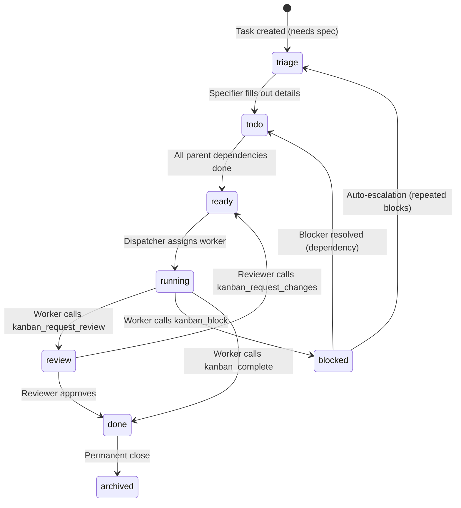

# Velvet Nadir — Big Update Brainstorm (Iteration 7)

> **Iteration 7** — Oct 2, 2026. Deep-dives honeypot 4-track architecture with zero-knowledge credential isolation, graceful port rotation via Zenoh dual-listen, rebalances NarrativeRadar between Tier 0 (too simple) and Tier 4 (overkill), redesigns output as multi-dimensional intelligence graph with demographic virality scoring, integrates with existing MemPalace KnowledgeGraph.

---

## ITERATION 7: Honeypot Depth, Intelligence Graph, Port Safety

### Honeypot — 4-Track Fake Environment

> You said: "we need at least 4-5 fake honeypot tracks, one leading to another, each revealing some authentic looking service."

Industry standard (MITRE Engage, Thinkst Canaries, T-Pot, Illusive Networks) converges on **3-4 hop tracks** as the sweet spot. Fewer than 3 and automated tools fingerprint the deception immediately. More than 4 and red-teamers notice the "infinite hall of mirrors" pattern and abort within 3 hops. The trick is making each hop feel like a genuine lateral movement discovery — not a breadcrumb trail.

#### The Four Tracks

Each track is a self-contained attack story. An attacker might enter via any standard port and follow one of these narratives:

**Track 1: "The Sloppy Developer" Path**
```
Port 22 (Fake SSH) ──► accepts admin:admin123
    └→ Fake ~/ with .bash_history showing "mysql -h localhost -u root -p..."
        └→ Fake .env file: DB_HOST=localhost, DB_PASS=s3cure_db_2024!
            └→ Port 3306 (Fake MySQL) ──► accepts those creds
                └→ Fake `users` table with "API keys"
                    └→ Port 8080 (Fake API) ──► accepts those keys
                        └→ TARPIT: infinite pagination, slow drip responses
                           Every request logged with full forensics
```

**Track 2: "The Exposed Cloud Infrastructure" Path**
```
Port 443 (Fake HTTPS) ──► Fake admin panel (looks like Portainer/Grafana)
    └→ Login page accepts leaked creds from Track 1's fake DB
        └→ Fake dashboard showing "Docker containers", "S3 buckets"
            └→ Port 9000 (Fake S3/MinIO) ──► "Public" bucket listing
                └→ Fake backup files: config.tar.gz, db_dump.sql
                    └→ Inside: more fake creds pointing to Port 5432
                        └→ Port 5432 (Fake Postgres) ──► TARPIT + canary data
```

**Track 3: "The IoT / Internal Network" Path**
```
Port 80 (Fake HTTP) ──► Fake router admin page (looks like OpenWRT/Ubiquiti)
    └→ Default creds (admin:password)
        └→ Fake network topology showing "internal devices"
            └→ Port 6379 (Fake Redis) ──► "No auth required" 
                └→ Fake session tokens, fake config keys
                    └→ Port 27017 (Fake MongoDB) ──► Fake collections
                        └→ Fake user documents with PII (all synthetic)
                            └→ TARPIT: ever-growing result sets, never completes
```

**Track 4: "The Exposed Management" Path**
```
Port 5900 (Fake VNC) ──► Fake desktop screenshot
    └→ Shows terminal window with "recent commands"
        └→ Port 2375 (Fake Docker API) ──► "Exposed Docker socket"
            └→ Fake container list, fake images
                └→ Port 8443 (Fake K8s Dashboard) ──► Fake pods/secrets
                    └→ "Kubernetes secrets" containing fake cloud API keys
                        └→ TARPIT: API responds with increasingly delayed,
                           authentic-looking but meaningless JSON
```

> [!IMPORTANT]
> **Cross-track credential seeding**: Fake creds discovered in Track 1's MySQL lead to Track 2's admin panel. Track 2's S3 backups contain creds for Track 3's Redis. This creates a web, not a line — the attacker feels like they're doing lateral movement across a real network.

---

### Credential Isolation — Zero-Knowledge Proof

> You said: "we also gotta make sure our real data, credentials, etc. doesn't ever get leaked into the fake stuff even by mistake... that needs to be zero knowledge proof."

#### The Architecture: Bloom Filter Guard

The honeypot generator NEVER sees real credentials. Instead, the production credential vault (BasiliskEnclave) exports a **one-way Bloom filter** that the honeypot uses to verify disjointness:

```
 BasiliskEnclave (real creds — air-gapped from honeypot)
    │
    │ 1. For each real secret: compute HMAC(vault_salt, secret)
    │ 2. Insert all hashes into a Bloom filter
    │ 3. Export ONLY the Bloom filter (not the secrets)
    ▼
 Bloom Filter (~100KB, non-invertible)
    │
    │ Transferred to honeypot subsystem
    ▼
 HoneypotCredentialGenerator
    │
    ├─► Generate candidate fake credential
    ├─► Compute HMAC(vault_salt, candidate)
    ├─► Test against Bloom filter:
    │     NOT IN FILTER → ✅ Proven zero collision. Safe to use.
    │     IN FILTER     → ❌ Possible collision. Discard, re-roll.
    └─► Deploy to honeypot service
```

**Mathematical guarantees:**
- Bloom filters have **zero false negatives**. If it says "not in filter," the candidate provably doesn't match any real credential.
- Small false positive rate (~0.1%) just means we occasionally discard a safe candidate and re-roll in microseconds.
- Even if an attacker roots the honeypot container, they get the Bloom filter + salt. A Bloom filter is **non-invertible** — you cannot reconstruct passwords from it.

#### Deterministic Fake Credential Generation

On top of the Bloom filter guard, credentials are generated deterministically from an HKDF-derived seed:

```python
class HoneypotCredentialFactory:
    """
    Generates reproducible fake creds from a master decoy seed.
    - Deterministic: same seed = same creds = no storage needed
    - Canary-prefixed: internal systems instantly recognize fakes
    - Bloom-verified: proven disjoint from real credential space
    """
    
    def __init__(self, master_seed: bytes, collision_filter: BloomFilter):
        self._seed = master_seed
        self._filter = collision_filter
    
    def generate(self, service: str, field: str) -> str:
        for attempt in range(100):  # 100 re-rolls max (effectively infinite)
            info = f"decoy:{service}:{field}:{attempt}".encode()
            derived = HKDF(SHA256, 32, b"velvet-decoy-v1", info).derive(self._seed)
            
            candidate = self._format(derived, field)
            
            # Zero-knowledge collision check
            hmac_val = hmac.new(self._vault_salt, candidate.encode(), 'sha256')
            if not self._filter.check(hmac_val.digest()):
                return candidate  # Proven safe
        
        raise SecurityError("Exhausted re-rolls — bloom filter unexpectedly full")
    
    def _format(self, raw: bytes, field: str) -> str:
        if field == "password":
            return base64.urlsafe_b64encode(raw[:18]).decode()
        elif field == "api_key":
            return "vlt_fake_" + raw.hex()[:32]  # Canary prefix
        elif field == "aws_key":
            return "AKIADECOY" + raw[:12].hex().upper()
```

> [!NOTE]
> **Canary prefixes** (`vlt_fake_`, `AKIADECOY`) let our own monitoring systems instantly recognize when a fake credential appears in ANY log — production, external, or otherwise. If we see `vlt_fake_` in an access log, someone hit a honeypot.

---

### Port Rotation — Graceful & Safe

> You said: "make sure this doesn't affect running tasks and is frequent enough."

#### Frequency

| Port Type | Rotation | Reasoning |
|-----------|----------|-----------|
| **Standard ports (22, 80, 443, etc.)** | **Never rotate** — permanent honeypots | They exist to catch attackers. Moving them defeats the purpose. |
| **Real mesh services (Zenoh, API, SSH)** | **Every 12 hours** on schedule (e.g. 03:00 and 15:00 UTC) | Balances security vs coordination overhead |
| **Emergency rotation** | **Immediate** — triggered if an unauthenticated probe hits a real port | Last resort; something slipped through |

#### How It Works Without Breaking Anything

Zenoh natively supports **multi-endpoint listening** — the key insight that makes this graceful:

```
TIME ──────────────────────────────────────────────────────►

03:00 UTC  ┌─ STEP 1: Spawn new listener on Port B (new random)
           │  Real service now listens on BOTH Port A and Port B
           │  All existing connections continue on Port A undisturbed
           │
03:01 UTC  ├─ STEP 2: Broadcast encrypted port map update
           │  velvet/mesh/security/port_rotation → all trusted peers
           │  Peers start connecting to Port B for new sessions
           │
03:05 UTC  ├─ STEP 3: Connection draining grace period
           │  New connections → Port B only
           │  Existing connections → still alive on Port A
           │  Gateway checks: _queue.empty() and len(_active_cancels) == 0
           │
03:10 UTC  ├─ STEP 4: Close Port A in real service
           │  All sessions have migrated to Port B
           │  Port A becomes available
           │
03:11 UTC  └─ STEP 5: Rebind Port A as additional honeypot (temporarily)
              Catches anyone who cached the old real port
```

**Why this is safe:**
- **Make-before-break**: New port is up and accepting connections BEFORE the old one closes
- **Zero message loss**: Zenoh's multi-locator support means peers establish the new link while the old one is still active
- **DisplayBridge (WebSocket UI)**: Sends `display/reconnect` payload with new port before tearing down — browser auto-reconnects
- **Active tasks untouched**: Gateway's priority queue and worker loops are purely in-memory asyncio — they don't care about the transport port underneath

The trust system integration follows the existing flow naturally:
- **Phase 1 (new device onboarding)**: PortMap written to `~/.velvet/velvet.toml` during `NativeDriver.inject_velvet()` alongside certs
- **Phase 2 (rotation updates)**: Broadcast via signed `VelvetMessage` on Zenoh (HMAC-SHA256 verified)
- **Phase 3 (post-biometric promotion)**: Full PortMap seeds transmitted alongside `ca.key` via SFTP in `TrustProvisioner.provision_device()`

---

### NarrativeRadar — Rebalanced Architecture

> You said: "now i think we have simplified it too much... compare this design with the last iteration thoroughly."

You're right. Tier 0 was over-simplified, Tier 4 was overkill. Let me find the real middle ground:

#### What We Already Have (that I forgot about)

**Velvet already has a full KnowledgeGraph.** [MemPalace](file:///d:/Open%20Projects/seamless_computing/sw/velvet/velvet/shen/jing.py) in Jing provides:
- `graph_add_entity(name, type)` — node creation
- `graph_add_relation(subject, predicate, object, valid_from)` — temporal edge creation
- `graph_invalidate(subject, predicate, object, ended)` — fact expiration
- `graph_timeline(entity)` — chronological entity history
- `get_graph_snapshot()` — full `{nodes: [], links: []}` for the D3 force-directed visualizer
- **Confidence scores** and **source provenance** on every triple
- SQLite-backed with WAL mode — runs on edge devices, no Neo4j needed

This means we DON'T need OpenCTI or Raphtory or any external graph database for Tier 0/1. We already have a temporal knowledge graph with visualization.

#### The Rebalanced Design: "Tier 1.5"

Not Tier 0 (too bare), not Tier 4 (too heavy). A practical middle ground that uses what we already have:

```
INGESTION — Information / Social
├── Headless browser (Playwright) — general-purpose scraping for any website
├── Telethon (Telegram MTProto) — direct protocol, no browser overhead, tracks forwarding chains
├── Twscrape (X/Twitter) — async scraping via session pool, no API fees
├── RSSHub (Docker) — converts 1000+ platforms to uniform feeds  
└── GDELT 2.0 GKG deltas (free, 15-min updates) — global macro baseline

INGESTION — Physical Event Correlation (from gods-eye-view)
├── USGS Earthquake API — real-time seismic events (free, no key)
├── NASA FIRMS — wildfires & thermal anomalies (free, no key)
├── OpenSky Network / adsb.lol — live flight tracking (free, open API)
├── AISStream — maritime vessel tracking (free WebSocket)
├── CelesTrak SGP4 — satellite orbit propagation (free TLE data)
├── TeleGeography — submarine cable map & outage correlation (free dataset)
├── Launch Library 2 — rocket & space launch events (free API)
└── NOAA GFS / ECMWF — weather, wind, hurricane tracking (free)
```

> [!NOTE]
> **[v7 CORRECTION]**: Headless browser alone is underkill for social ingestion. Dedicated protocol clients (Telethon, Twscrape) for high-volume platforms. Physical event feeds (all from gods-eye-view, all free/keyless) enable the critical function of distinguishing **organic narratives** (earthquake happened → "earthquake" trends = real) from **manufactured narratives** (no physical event → narrative appears from coordinated sources = suspicious). Every physical feed follows the modular lifecycle pattern: `mount()`, `poll()`, `interpolate()`, `unmount()`.


```
PROCESSING  
├── BERTopic — streaming topic clustering + anomaly detection
├── Local LLM — entity extraction, summarization, relationship inference
└── Trafilatura — clean text extraction from raw URLs

GRAPH & STORAGE (ALREADY EXISTS)
├── MemPalace KnowledgeGraph — temporal entity-relationship graph
├── Jing/Tartarus — chronological intelligence log
├── Jing/Mnemosyne — vector similarity for narrative matching
└── DisplayBridge D3 visualizer — graph exploration UI (ALREADY EXISTS)

ANALYSIS (built incrementally)
├── Velocity scoring — BERTopic cluster growth rate
├── Demographic penetration scoring — custom (see below)
└── LLM reasoning — natural language queries against the graph
```

#### Comparison: Tier 0 vs Tier 1.5 vs Tier 4

| Dimension | Tier 0 (too simple) | **Tier 1.5 (what we build)** | Tier 4 (overkill) |
|-----------|--------------------|-----------------------------|-------------------|
| **Ingestion** | Headless browser + RSSHub only | Headless browser + Telethon + Twscrape + RSSHub + GDELT | 6+ specialized scrapers + full firehose subscriptions |
| **Processing** | BERTopic + LLM summary only | BERTopic + LLM entity extraction + relationship inference | GraphRAG + CooRnet + NDlib |
| **Graph** | None (just text clusters) | **MemPalace KnowledgeGraph (already built!)** | OpenCTI + Raphtory + PyGraphistry |
| **Visualization** | Text-only daily brief | **D3 force-directed graph (already built!) + daily brief** | Cesium 3D globe + PyGraphistry GPU cockpit |
| **Storage** | Jing only | Jing + MemPalace SQLite (already exists) | OpenCTI + Elasticsearch + Redis + MinIO |
| **Extra infra needed** | None | RSSHub Docker container + BERTopic pip package | Docker Compose stack with 6+ containers |
| **Compute footprint** | Minimal | Light — CPU sentence-transformer + existing LLM | Heavy — multiple GPU-accelerated services |
| **Actor profiling** | None | LLM extracts entities → MemPalace stores relationships | Maigret + SpiderFoot + OpenSanctions |
| **Can reason with LLM** | ❌ (flat text) | ✅ (graph_query + graph_timeline) | ✅ (GraphQL + STIX2) |
| **Selective tracking** | ❌ | ✅ (topic watchlist, enable/disable per branch) | ✅ |

**gods-eye-view comparison**: Great project, but solves a different problem (physical/GEOINT). Key things we steal from it:
- **Modular layer lifecycle**: Each data feed is an independent module with `mount/poll/unmount`. We adopt this for our feed modules.
- **GDELT/USGS/FIRMS free data**: Use their public feeds to correlate physical events with narrative spikes (earthquake happens → narrative spike is organic vs. no physical event → narrative is manufactured)
- **Tier 4 visual frontend**: When/if we build the full intelligence cockpit, CesiumJS is the globe template

---

### The Multi-Dimensional Intelligence Output

> You want: (1) power/incentive graph, (2) trickle-down to demographics, (3) relative virality scoring, (4) LLM-queryable, (5) selective tracking of 3-4 topics that can grow.

This is the real output. Not just a daily brief — a **living intelligence graph** stored in MemPalace.

#### The Graph Structure

```python
# The intelligence graph lives in MemPalace KnowledgeGraph
# Entity types and relationship types:

ENTITY_TYPES = {
    # Top tier — power nodes
    "government":      "National government or executive office",
    "institution":     "Central bank, IMF, WHO, NATO, etc.",
    "corporation":     "Major corporation affecting the masses",
    "private_equity":  "PE firm, hedge fund, family office",
    "shadow_network":  "Informal power network, old boys club, cartel",
    "think_tank":      "Policy institute, foundation",
    "media_outlet":    "News organization, social platform",
    
    # Mid tier — amplifiers and executors
    "political_leader":  "PM, president, minister, senator",
    "executive":         "CEO, board member, lobbyist",
    "influencer":        "Public figure, commentator, activist",
    "organization":      "NGO, trade union, industry group",
    
    # Bottom tier — demographics and communities
    "demographic":     "Scientists, gamers, beauty consumers, etc.",
    "community":       "Subreddit, forum, Telegram group, etc.",
    "geography":       "Country, region, city",
    
    # Narrative objects
    "narrative":       "A tracked story/meme/claim",
    "event":           "A real-world event (earthquake, law, election)",
    "campaign":        "A coordinated push (organic or astroturfed)",
}

RELATION_TYPES = {
    # Power relations
    "funds":           "X funds Y (think_tank → media_outlet)",
    "owns":            "X owns Y (corporation → media_outlet)",
    "board_member_of": "X sits on board of Y",
    "lobbies":         "X lobbies Y (corporation → government)",
    "influences":      "X influences Y (shadow_network → political_leader)",
    
    # Narrative relations
    "pushes":          "X pushes narrative Y",
    "amplifies":       "X amplifies narrative Y",
    "originates":      "X is the origin of narrative Y",
    "benefits_from":   "X benefits from narrative Y succeeding",
    "opposes":         "X opposes narrative Y",
    
    # Propagation
    "penetrates":      "Narrative Y penetrates demographic Z (with score)",
    "trickles_to":     "Effect trickles from org X to demographic Z",
    
    # Incentive
    "incentive":       "X has incentive Y (financial, political, CYA, ideological)",
}
```

#### The Trickle-Down Graph (Visualized)

```
TIER 1: POWER NODES
┌──────────┐     funds      ┌──────────────┐    owns     ┌─────────────┐
│ BlackRock │───────────────►│ Council on FR │───────────►│ Foreign Aff. │
│ (PE)      │                │ (think_tank)  │            │ (media)      │
└────┬──────┘                └──────┬───────┘            └──────┬──────┘
     │ lobbies                      │ pushes                    │ amplifies
     ▼                              ▼                           ▼
TIER 2: AMPLIFIERS
┌──────────────┐            ┌──────────────────┐        ┌──────────────┐
│ Sen. Smith    │            │ "ESG is essential"│        │ Reuters      │
│ (pol_leader)  │            │ (narrative)       │        │ (media)      │
└──────────────┘            └────────┬─────────┘        └──────┬───────┘
                                     │ penetrates               │ 
                                     ▼                          ▼
TIER 3: DEMOGRAPHICS
┌───────────────────────────────────────────────────────────────────────┐
│ "ESG is essential" penetrates:                                        │
│                                                                       │
│ ● Finance professionals:  ████████████░░ 82%  (virality: HIGH)       │
│ ● Tech workers:           ██████░░░░░░░░ 45%  (virality: MODERATE)   │
│ ● Retail investors:       ███░░░░░░░░░░░ 22%  (virality: LOW)        │
│ ● General public:         █░░░░░░░░░░░░░  8%  (virality: NEGLIGIBLE) │
└───────────────────────────────────────────────────────────────────────┘
```

#### Demographic Virality Scoring

> You said: "1000 views in scientific community is much more 'viral' than 1000 views in beauty industry."

```python
class DemographicViralityScorer:
    """
    Scores narrative penetration RELATIVE to the size and density
    of the target demographic, not absolute numbers.
    
    DOES NOT hardcode demographic sizes. Instead, the system learns
    and infers community sizes from multiple signals:
    """
    
    def __init__(self, jing: Jing):
        self._jing = jing  # Uses MemPalace to store & refine estimates
    
    async def estimate_pool_size(self, demographic: str) -> int:
        """
        Infer demographic size from observed data, not hardcoded tables.
        
        Sources (weighted, combined):
        1. Observed activity — how many unique accounts/authors has NarrativeRadar
           seen posting in this demographic's communities over time?
           (e.g., unique posters in r/MachineLearning, Telegram AI channels)
        2. Platform metadata — subreddit subscriber counts, Telegram channel
           member counts, Twitter list sizes, LinkedIn group sizes
        3. GDELT/public statistics — when available, cross-reference with
           GDELT's entity co-occurrence volumes for scale calibration
        4. Historical learning — MemPalace stores past estimates and refines
           them as more data flows through the system
        """
        # Check if we have a learned estimate in MemPalace
        history = self._jing.graph_query(f"demographic_size:{demographic}")
        if history:
            # Use the most recent estimate, weighted by confidence
            return history[-1].properties.get("estimated_size", 100_000)
        
        # Bootstrap: estimate from observed unique authors in this space
        observed = await self._count_unique_authors(demographic)
        
        # Apply Chao1-style estimator: observed sample → true population
        # (standard ecological diversity estimator adapted for online communities)
        # The assumption: we see ~1-10% of a community's active members
        # in any given observation window
        estimated = observed * self._coverage_multiplier(demographic)
        
        # Store in MemPalace for future refinement
        self._jing.graph_add_entity(
            f"demographic:{demographic}", "demographic",
            properties={"estimated_size": estimated, "method": "chao1_bootstrap"}
        )
        
        return estimated
    
    async def score(self, narrative: str, demographic: str, 
                    reach: int, engagement: int) -> ViralityScore:
        
        pool_size = await self.estimate_pool_size(demographic)
        
        # Penetration ratio: what fraction of the demographic was reached
        penetration = reach / pool_size
        
        # Engagement depth: of those reached, how many engaged
        engagement_rate = engagement / max(reach, 1)
        
        # Virality = penetration × engagement, normalized to 0-100
        raw_score = (penetration * 0.6 + engagement_rate * 0.4) * 100
        
        # Classify
        if raw_score > 70: level = "CRITICAL"
        elif raw_score > 40: level = "HIGH"
        elif raw_score > 15: level = "MODERATE"
        elif raw_score > 5: level = "LOW"
        else: level = "NEGLIGIBLE"
        
        return ViralityScore(
            narrative=narrative,
            demographic=demographic,
            reach=reach,
            pool_size=pool_size,
            penetration_pct=penetration * 100,
            engagement_rate=engagement_rate,
            score=raw_score,
            level=level,
        )

# The system LEARNS that the particle physics community is small
# because it sees the same ~200 unique authors cycling through
# its tracked channels. It LEARNS that beauty consumers are huge
# because it sees 50,000+ unique accounts in a single day's scrape.
# No hardcoding needed — the intelligence emerges from observation.
```


#### Selective Topic Tracking

> You said: "start with 3-4 things... with the ability to grow it into a bigass global intelligence network in the future."

```python
# In config or user settings:

class NarrativeRadarConfig:
    """
    User selects which branches to track. Each branch is a topic
    with its own ingestion sources, entity tracking, and scoring.
    
    Start with 3-4. Each one will generate entities, relationships,
    and virality scores in MemPalace. Turn on/off per branch.
    """
    
    active_branches: list[IntelBranch] = [
        IntelBranch(
            name="AI Regulation & Safety",
            keywords=["ai regulation", "ai safety", "frontier model", "EU AI Act"],
            sources=["rss:techcrunch", "rss:arxiv-cs-ai", "reddit:r/machinelearning"],
            track_demographics=["ai_researchers", "tech_workers", "policymakers"],
            enabled=True,
        ),
        IntelBranch(
            name="Cybersecurity Threats",
            keywords=["zero-day", "CVE-", "ransomware", "APT", "data breach"],
            sources=["rss:krebsonsecurity", "rss:hackernews", "telegram:cybersec"],
            track_demographics=["cybersecurity_pros", "software_engineers"],
            enabled=True,
            # This one also auto-checks if threats affect YOUR mesh
            mesh_threat_check=True,
        ),
        IntelBranch(
            name="Geopolitical Shifts",
            keywords=["sanctions", "trade war", "BRICS", "NATO", "Taiwan"],
            sources=["gdelt", "rss:reuters", "rss:foreignaffairs"],
            track_demographics=["policymakers", "finance_professionals"],
            enabled=True,
        ),
    ]
    
    # Storage budget per branch (prevent filling disk on day one)
    max_entities_per_branch: int = 5000
    max_triples_per_branch: int = 20000
    retention_days: int = 90  # Tartarus auto-prunes older than this
```

Each branch grows its own subgraph in MemPalace. You can enable/disable branches. You can add new ones anytime. The graph grows organically — exponentially within a branch, but bounded by the storage budget you set.

#### LLM Reasoning Over the Graph

Since the graph lives in MemPalace (Jing), the existing LLM pipeline can already query it:

```
User: "Who is pushing the 'AI regulation' narrative and why?"

LLM → Jing.graph_query("AI regulation") → Returns:
  - Entity: "EU Commission" (government) — pushes "EU AI Act" (narrative)
  - Entity: "OpenAI" (corporation) — lobbies "EU Commission" — benefits_from: regulatory moat
  - Entity: "Meta" (corporation) — opposes "EU AI Act" — incentive: open source constraints  
  - Penetration: ai_researchers 67% (HIGH), general_public 12% (LOW)
  
LLM synthesizes: "The EU AI Act narrative is primarily pushed by the EU Commission,
with lobbying support from OpenAI (which benefits from regulatory moats against 
open-source competitors). Meta opposes it due to potential constraints on open-source 
model releases. The narrative has high penetration among AI researchers (67%) but 
low general public awareness (12%)."
```

This works TODAY with the existing architecture. No new infrastructure needed — just populate the graph.

#### The Widget Vision

The daily brief is ONE output. The real widget is the **interactive intelligence graph explorer** — and we already have the D3 force-directed visualizer in DisplayBridge.

**Two widgets, not one:**

1. **Daily Intelligence Brief** — passive notification summarizing what changed overnight (this is the text format shown in v6)
2. **Intelligence Graph Explorer** — interactive D3 graph widget showing power nodes, narrative flows, demographic penetration, trickle-down paths. Click any node to see timeline, relationships, virality scores. This is the real "applet" — built on top of the existing `get_graph_snapshot()` → DisplayBridge → WebSocket UI pipeline.

Both go on the UI roadmap. The graph explorer is more ambitious but the plumbing already exists.

---

### gods-eye-view — What We Steal

Analyzed the [gods-eye-view](https://github.com/bilawalsidhu/gods-eye-view) repo (Halfpixel.ai). It's a CesiumJS-based 3D globe for physical/geospatial intelligence — flights, ships, satellites, fires, quakes. Different problem from ours (physical vs. information), but three things we take:

1. **Modular feed lifecycle**: Every data source is an independent module with `mount()`, `poll()`, `interpolate()`, `unmount()`, `getMetadata()`. We adopt this exact pattern for NarrativeRadar feed modules (RSS, Telegram, Bluesky, GDELT).

2. **Free public data connectors**: GDELT, USGS earthquakes, NASA FIRMS wildfires — all free, no API keys, 15-minute updates. We use these to correlate physical events with narrative spikes. If an earthquake happens and "earthquake" trends, it's organic. If "quantum computing breakthrough" trends with no physical event, it might be manufactured.

3. **Tier 4 visual template**: When NarrativeRadar matures into a full intelligence workstation, CesiumJS is the globe template for anchoring narratives to geography. But that's a later expansion — not now.

---

## ITERATION 6: Port Inversion, Intelligence Simplification, Outputs

> [!NOTE]
> **[v7 CORRECTIONS]**: (1) Honeypot expanded to 4 tracks with cross-track credential seeding. Bloom filter zero-knowledge credential isolation added. (2) NarrativeRadar rebalanced from "Tier 0" (too simple) to "Tier 1.5" — uses EXISTING MemPalace KnowledgeGraph and D3 visualizer. (3) Output redesigned as multi-dimensional intelligence graph with power mapping, trickle-down, and demographic virality scoring. (4) Port rotation: 12-hour cadence with Zenoh dual-listen make-before-break. (5) Widget vision: two widgets — daily brief (passive) + intelligence graph explorer (interactive). (6) gods-eye-view: modular feed pattern adopted, GDELT/USGS free data for physical event correlation.

---

## ITERATION 6: Port Inversion, Intelligence Simplification, Outputs

### Honeypot Port Inversion — The Architecture

The idea: **standard ports ARE the honeypots. Real services hide on non-standard ports that only trusted, onboarded devices know.**

An attacker running `nmap` against your mesh sees ports 22, 80, 443, 3306, 8080 all "open." They think they found SSH, a web server, a database. But every single one is a trap. The real SSH is on port 47832. The real Zenoh fabric is on port 51234. The real services are invisible unless you were onboarded and given the port map.

#### How It Works — Three Layers

**Layer 1: The Port Map (Trusted Devices Only)**

When a device is onboarded to the mesh (via `TrustProvisioner` + Basilisk authentication), it receives a signed port map as part of the trust handshake:

```python
# Part of the onboarding handshake in trust_provisioner.py

class PortMap:
    """
    Maps logical services to their actual non-standard ports.
    
    This map is:
    - Generated uniquely per mesh instance (randomized on first boot)
    - Encrypted in BasiliskEnclave at rest
    - Transmitted only during Basilisk-authenticated onboarding
    - Rotatable: the mesh can re-roll ports and push new maps to all trusted devices
    """
    
    # Example — these are randomized per mesh instance
    services: dict[str, int] = {
        "ssh":    47832,   # NOT 22
        "zenoh":  51234,   # NOT 7447
        "https":  39441,   # NOT 443
        "api":    62017,   # NOT 8080
        "mqtt":   44891,   # NOT 1883
    }
    
    # How ports are generated:
    # 1. On first mesh boot, pick random ports in range 30000-65000
    # 2. Verify they don't collide with each other or known services
    # 3. Store encrypted in BasiliskEnclave
    # 4. Distribute during onboarding only
    
    @classmethod
    def generate(cls) -> "PortMap":
        """Generate a fresh randomized port map."""
        used = set()
        services = {}
        for service_name in cls.REQUIRED_SERVICES:
            while True:
                port = random.randint(30000, 65000)
                if port not in used:
                    used.add(port)
                    services[service_name] = port
                    break
        return cls(services=services)
```

**Layer 2: Standard Ports → Honeypots**

Every standard port that an attacker would expect is bound to a honeypot service:

```python
# In velvet/privacy/honeypot_vulns.py — expanded

class HoneypotPortBinder:
    """
    Binds ALL standard/well-known ports to honeypot services.
    These are the FIRST thing an attacker hits during port scanning.
    """
    
    STANDARD_PORT_TRAPS = {
        # The attacker expects these. We give them what they expect.
        22:    "fake_ssh",        # Weak creds that "work" → fake filesystem
        80:    "fake_http",       # Fake web server → fake admin panel
        443:   "fake_https",      # Same, with self-signed cert (looks sloppy)
        3306:  "fake_mysql",      # Accepts connections → fake tables
        5432:  "fake_postgres",   # Same
        8080:  "fake_api",        # "Debug mode enabled" → fake tokens
        8443:  "fake_mgmt",       # Fake management console
        27017: "fake_mongodb",    # "No auth required" → fake collections
        6379:  "fake_redis",      # "No password" → fake keys with more fake creds
        9000:  "fake_s3",         # "Public buckets" → fake backups
        2375:  "fake_docker_api", # "Exposed Docker socket" → fake containers
        5900:  "fake_vnc",        # Fake VNC → shows a fake desktop
        3389:  "fake_rdp",        # Fake RDP → leads nowhere
    }
    
    async def bind_all(self):
        """Bind every standard port to its corresponding honeypot."""
        for port, trap_type in self.STANDARD_PORT_TRAPS.items():
            await self._start_trap(port, trap_type)
            logger.info(f"[Honeypot] Port {port} → {trap_type}")
```

**Layer 3: The Attack Flow**

```
ATTACKER                               YOUR MESH

1. nmap scan ──────────────────────►  Ports 22, 80, 443, 3306... all "open" ✓
                                      (These are ALL honeypots)

2. SSH to port 22 ────────────────►  Fake SSH accepts admin:admin123
   "I'm in!" (they think)             Fake filesystem, fake configs
                                      Fake /etc/shadow with "database creds"

3. MySQL to port 3306 ───────────►   Fake MySQL accepts the creds from step 2
   "Found the DB!" (they think)       Fake tables: users, api_keys, credentials
                                      Fake API keys that point to port 8080

4. API on port 8080 ─────────────►   Fake REST API accepts the keys from step 3
   "Debug mode!" (they think)         Fake /debug/tokens endpoint
                                      Returns "S3 credentials"

5. S3 on port 9000 ─────────────►    Fake S3 with "public" buckets
   "Jackpot!" (they think)           Fake backup files with more fake creds...
                                     
   ∞ INFINITE LOOP                    Every step logged with full forensics

MEANWHILE:
Real SSH on port 47832 ──────────►   Invisible to the attacker
Real Zenoh on port 51234 ────────►   They don't even know to look here
Real API on port 62017 ──────────►   Protected by TLS + Basilisk auth
```

**Layer 4: The Firewall Rules**

The actual network enforcement:

```python
# Network configuration during mesh boot

class MeshNetworkSetup:
    async def configure_firewall(self, port_map: PortMap):
        """
        1. REAL services: Only accept connections from trusted mesh IPs
           (verified by TrustEngine during onboarding)
        2. HONEYPOT ports: Accept connections from ANYONE
        3. Everything else: DROP (stealth, no ICMP reject)
        """
        
        # Real services — only trusted peers
        for service, port in port_map.services.items():
            for trusted_ip in self.trust_engine.get_trusted_ips():
                await self._allow(port, source_ip=trusted_ip)
            await self._drop_default(port)  # Everyone else: silent drop
        
        # Honeypot ports — open to all (that's the point)
        for port in HoneypotPortBinder.STANDARD_PORT_TRAPS:
            await self._allow(port, source_ip="0.0.0.0/0")
        
        # Everything else — stealth drop (no ICMP unreachable)
        await self._default_policy("DROP")
```

**Port Rotation:**

The mesh can periodically re-roll its real service ports and push new maps to all trusted devices via Zenoh. This means even if an attacker somehow discovers a real port, it moves:

```python
async def rotate_ports(self):
    """Re-randomize real service ports. Push new map to trusted devices."""
    new_map = PortMap.generate()
    
    # 1. Notify all trusted peers over existing Zenoh connection
    await self.fabric.publish("velvet/mesh/security/port_rotation", {
        "new_map": self.basilisk.encrypt(new_map.to_dict()),
        "effective_at": (datetime.utcnow() + timedelta(minutes=5)).isoformat(),
    })
    
    # 2. After grace period, rebind services to new ports
    # 3. Old ports become additional honeypots briefly, then close
```

> [!IMPORTANT]
> **The key insight**: Attackers EXPECT standard ports. We exploit that expectation. They scan, find "open" services, feel confident they've penetrated the network, and spend hours/days exploring a completely fake environment. Meanwhile, the real mesh is on randomized ports they'd need a brute-force scan of 35,000 ports to even find — and even then, they'd hit TLS + Basilisk mutual authentication.

---

### NarrativeRadar — Honest Simplification

> You asked: "are you confident? could this be better? are we overusing too many tools here? could this be simpler? how will this function across the mesh? can't some of it just be headless browser use?"

**Honest answer: yes, the v5 architecture was overengineered.** I listed every possible tool in the OSINT landscape. For a personal mesh system, we don't need all of that on day one. Let me separate what's actually essential from what's nice-to-have expansion.

#### What We Actually Need (The Core)

Strip it down to **three things** that run on any mesh node:

```
                    ┌─────────────────────────────┐
                    │     1. INGESTION             │
                    │  Headless browser + RSSHub   │
                    │  (scrape anything, feed RSS) │
                    └──────────────┬──────────────┘
                                   │ raw text + media
                                   ▼
                    ┌─────────────────────────────┐
                    │     2. PROCESSING            │
                    │  BERTopic (topic clustering) │
                    │  + Local LLM (summarization) │
                    └──────────────┬──────────────┘
                                   │ clusters + summaries
                                   ▼
                    ┌─────────────────────────────┐
                    │     3. STORAGE & OUTPUT       │
                    │  Jing (Tartarus for history,  │
                    │  Mnemosyne for similarity)    │
                    └─────────────────────────────┘
```

That's it. The core is **headless browser scraping → topic modeling → memory**. A single mesh node can run this. No Docker Compose stacks with Elasticsearch+Redis+MinIO. No separate graph database.

**Why headless browser covers most of it:**
- You're right — a headless browser (Playwright/Puppeteer) can scrape Twitter, Instagram, Telegram Web, Reddit, news sites, think tank publications, government press releases. No specialized scraping libraries needed for each platform.
- RSSHub handles the stuff that's easy to RSS-ify. Headless browser handles everything else.
- Together, they replace Telethon + Twscrape + Huginn + Trafilatura for the simple "just get the content" use case.

**Why BERTopic is the only processing tool we need initially:**
- BERTopic does streaming dynamic topic modeling with a small local sentence-transformer (runs on CPU)
- It answers "what's trending?" and "what's emerging?" natively via `topics_over_time()`
- Spike detection (>3σ velocity in a cluster) gives us anomaly alerts
- No need for GraphRAG, CooRnet, NDlib, or Raphtory on day one

**What the local LLM adds:**
- We already have LLM inference on the mesh. Use it to summarize each topic cluster into a human-readable brief.
- "Here's what's trending today: [summary]. Key narrative: [X]. Unusual spike in: [Y]."

#### The Expansion Tiers (Build Later, If Needed)

| Tier | What It Adds | When to Build |
|------|-------------|--------------|
| **Tier 0 (Core)** | Headless browser + RSSHub + BERTopic + local LLM summaries → Jing | **Now** |
| **Tier 1: Actor Profiling** | Maigret (username recon across 3000+ platforms) + SpiderFoot (domain/infra OSINT) | When you want to investigate specific actors/operators |
| **Tier 2: Power Mapping** | FollowTheMoney + OpenSanctions + LittleSis | When you want "who funds this narrative" answers |
| **Tier 3: Coordination Detection** | CooRnet (synchronized posting detection) + Raphtory (temporal cascade graphs) | When you want to detect bot farms and coordinated campaigns |
| **Tier 4: Full Intelligence Platform** | OpenCTI (STIX2 graph) + DISARM (TTP taxonomy) + PyGraphistry (visual cockpit) | When NarrativeRadar matures into a dedicated intelligence workstation |

Each tier is additive. You can run for months on Tier 0 alone. The v5 architecture was showing the full Tier 4 ceiling — but you build toward it, not start there.

#### The Shape of the Output

What does the user actually SEE from NarrativeRadar?

**Daily Intelligence Brief** (delivered as a notification or widget):

```
┌──────────────────────────────────────────────────────────────┐
│  📡 NARRATIVE RADAR — Daily Brief (Sep 30, 2026)             │
│                                                              │
│  TOP NARRATIVES TODAY:                                       │
│                                                              │
│  🔵 1. "AI regulation bill advances in EU"                   │
│     Volume: ████████░░ 78%  |  Velocity: ▲ Rising            │
│     Sources: Reuters, Politico EU, 47 Twitter threads         │
│     Sentiment: Mixed (52% supportive, 31% critical)          │
│                                                              │
│  🟡 2. "New zero-day in popular router firmware"              │
│     Volume: █████░░░░░ 45%  |  Velocity: ▲▲ Spiking          │
│     Sources: Krebs, HackerNews, 12 security blogs             │
│     ⚠️ SECURITY ALERT: Affects devices in your mesh?          │
│                                                              │
│  🟢 3. "SpaceX Starship test window opens"                    │
│     Volume: ████░░░░░░ 38%  |  Velocity: ─ Stable            │
│     Sources: NASA, SpaceNews, Reddit r/space                  │
│                                                              │
│  📊 ANOMALY DETECTED:                                        │
│  Unusual 4σ spike in "quantum computing breakthrough"         │
│  across 3 coordinated Telegram channels and 2 news sites.    │
│  First appearance: obscure Chinese-language blog (06:14 UTC) │
│  → Translated and reposted by 2 English-language outlets     │
│  → Now trending on X. Propagation speed: unusually fast.     │
│                                                              │
│  🕵️ PHANTOM ACTIVITY REPORT:                                 │
│  Used 3 trending topics for phantom browsing today:          │
│  "AI regulation", "router firmware", "Starship"              │
│  TrackerPolluter: 12 fake queries generated                   │
│  AIToolNoise: 4 phantom chatbot sessions completed            │
├──────────────────────────────────────────────────────────────┤
│  [View Full Report]  [Investigate Anomaly]  [Dismiss]        │
└──────────────────────────────────────────────────────────────┘
```

**If you click "Investigate Anomaly"** (Tier 1+ functionality, when built):

```
┌──────────────────────────────────────────────────────────────┐
│  🔍 ANOMALY INVESTIGATION: "quantum computing breakthrough"  │
│                                                              │
│  PROPAGATION CHAIN:                                          │
│  06:14 UTC — obscure blog (quantumfuture.cn)                 │
│    └→ 07:02 UTC — @TechNewsFeed42 (Telegram, 12k followers)  │
│       └→ 07:31 UTC — @QuantumDaily (Twitter/X, 89k followers)│
│          └→ 08:15 UTC — TechRadar.com (article)              │
│             └→ 09:00 UTC — Trending on X (#QuantumBreakthrough│
│                                                              │
│  ⚠️ COORDINATION SIGNALS:                                    │
│  • 3 Telegram channels posted within 8 minutes of each other │
│  • 2 of 3 channels share admin (same phone prefix)           │
│  • Blog domain registered 3 weeks ago (newly created)        │
│                                                              │
│  VERDICT: Possible coordinated amplification campaign.       │
│  Confidence: Medium (67%)                                    │
└──────────────────────────────────────────────────────────────┘
```

#### How It Functions Across the Mesh

NarrativeRadar runs as a BreathTask on ONE node (the one with the most CPU headroom, selected by Xi). The results go to Jing → replicated across all nodes via MeshMemorySync. So:

- **Scraping/processing**: happens on one node (no duplicate work)
- **Results**: available on every node (because memory is mesh-wide)
- **Queries**: any node can ask "what's trending?" and get the answer from its local Jing

If the primary node goes offline, Xi on another node picks up the BreathTask automatically.

#### Widget Roadmap Note

> [!NOTE]
> **[v6 ROADMAP]**: NarrativeRadar should eventually become an interactive widget/applet in the Velvet UI system. The daily brief format above maps naturally to the existing `DisplayBridge` → `widget_library.py` → WebSocket UI pipeline. This goes on the UI roadmap for after the core intelligence engine is functional.

---

### Doc Cleanup — Corrected

> [!NOTE]
> **[v6 CORRECTION]**: Don't delete any docs. Rewrite on top, preserving original content below.

Updated plan:

1. 🔴 **Rewrite on top** of `docs/EXTENSIBILITY.md` — add current extensibility architecture (skills, MCP, LimenGateway) as a new section at the top, keep original content below as historical
2. 🔴 **Rewrite on top** of `docs/VISION.md` — add current vision/architecture at the top, keep founding vision below as historical context
3. 🔴 **Rewrite** `sw/velvet/README.md` — replace Sprint 1 references with actual Project Shen architecture, add migration note about what changed
4. 🟡 **Update** `docs/handoff.md` — fix file tree, add missing modules
5. 🟡 **Update** `docs/PROGRESS.md` — unfreeze module list
6. 🟢 **Create** doc stubs for 16 undocumented modules
7. 🟢 **Consolidate** `bus_drivers.py` vs `drivers/bus.py`

---

## ITERATION 5: Answers, Architecture, Intelligence

> [!NOTE]
> **[v6 CORRECTIONS]**: (1) Honeypot architecture elaborated — standard ports are honeypots, real services on randomized non-standard ports, port rotation supported. (2) NarrativeRadar simplified — Tier 0 core is just headless browser + BERTopic + local LLM, full OSINT stack is expansion tiers for later. (3) Output shape shown — daily intelligence brief format. (4) Docs: rewrite on top, never delete original content.

---

## ITERATION 5: Answers, Architecture, Intelligence

### Q1 Answer: Global Perturbation Slider

**Decision: One global slider**, tuned strong enough to survive the worst-case platform (Instagram). The engine auto-adjusts epsilon internally per destination, but the user sees a single knob.

```python
# User sets ONE global level in settings
class PrivacyConfig:
    perturbation_strength: Strength = Strength.BALANCED  # Global knob
    
# The PerturbationEngine internally adjusts per destination
# but the user doesn't have to think about per-platform settings.
# BALANCED globally = AGGRESSIVE internally for Instagram, 
# BALANCED for X/YouTube, SUBTLE for Signal/direct shares.
```

**Tier 3 (experimental) — SKIPPED.** Not building real-time video perturbation, lossy audio codec survival, or text anti-scraping. Focus on Tier 1 (metadata + direct share perturbation) and Tier 2 (social media image perturbation with epsilon boost).

---

### Q2 Answer: Phantom Personas — Consistent Forever

**Decision:** Phantom personas are **persistent identities**, consistent forever. User manually requests creation of new ones. Scaling grows organically.

Each phantom persona has:
- Consistent name, avatar, bio, interests
- Long-running browsing/posting history (built over weeks/months for believability)
- Dedicated interest profile fed by NarrativeRadar trends
- Separate browser fingerprint / cookie jar per persona

No auto-rotation, no aging out, no expiration. The user controls how many and when to create new ones.

---

### Q3 Answer: Honeypot — Passive Only, Never Broadcast

**Decision:** The honeypot vulnerability engine **never broadcasts or attracts attention**. It doesn't advertise itself. It's purely a trap for traffic that finds you anyway.

- No port scanning your own mesh from outside to "test"
- No Shodan exposure or deliberate indexing
- Just: if someone knocks on a fake port, they enter the infinite loop
- Monitoring frequency: Already decided — `CanaryMonitor` runs hourly as a BreathTask
- Forensic logs go to Tartarus for permanent record

---

### Q5 Answer: Framework First, Not Platform-Specific

**Decision:** Build the **egress protection framework** at the system level first. Then individual platform modules plug into it.

```
Everything leaving the mesh → EgressGuard (system-level)
    ├── MetadataStripper (always)
    ├── PerturbationEngine (media detection + perturbation)
    ├── PrivacyGuard (PII check)
    └── MirageProxy (if headed to cloud LLM)

Platform modules (InstagramModule, XModule, etc.) are CONSUMERS 
of the framework, not the framework itself. They handle platform-specific
API quirks, rate limits, and phantom persona behaviors.
```

The framework intercepts at the Gateway level. Any data leaving the mesh passes through it regardless of destination.

---

### Q6 Answer: Full 7-Stage Error Classification

**Decision:** All 7 stages. No shortcuts.

---

### Q7 Answer: REAL_WORLD_READINESS.md — What We Missed

Read it cover to cover. It's a good template but NOT a spec. Here's the gap analysis:

**Things in REAL_WORLD_READINESS.md we hadn't discussed yet:**

| Mechanism | Description | Our Status |
|-----------|------------|------------|
| **Surrogate/Unicode sanitization** | Strip `U+D800`–`U+DFFF` from pastes, non-ASCII from API keys | Not discussed. **Add to reliability scope.** |
| **Provider phrase banks** | Per-provider keyword matching for undocumented error messages (MiniMax, OpenRouter, Codex quirks) | Not discussed. **Add — we run on multiple providers.** |
| **Exponential token doubling on truncation** | When `finish_reason=="length"` with partial tool JSON, retry with 2×/4×/8×/16× `max_tokens` up to 32k | Not discussed. **Critical — this prevents lost tool calls.** |
| **Mixed-batch tool execution** | When LLM emits 3 tool calls and 1 is malformed, execute the valid 2 and error only the bad one | Not discussed. **Add — currently Velvet probably drops the whole batch.** |
| **Pre-execution intent logging in Jing** | Write `executed=False` to memory BEFORE calling a tool. On crash recovery, replay or park. | Not discussed. **Critical for crash resilience.** |
| **Thinking-budget exhaustion** | Detect when a reasoning model spends 100% tokens in `<think>` tags and never produces output | Not discussed. **Add — especially relevant for local models.** |
| **Sliding-window repetition guard** | Algorithmic abort when output loops (fragment ≥400 chars repeating ≥5× in a 60-token window) | Not discussed at this precision. **Adopt exact parameters.** |

**Things we discussed that REAL_WORLD_READINESS.md DOESN'T cover:**

| Our Brainstorm Topic | What's Missing from the RFC |
|---------------------|---------------------------|
| **Independent goal judge on a different model/node** | RFC's `verify_gate()` re-prompts the SAME model — doesn't address confirmation bias |
| **Mesh skill distribution/discovery** | RFC treats skills as local-only. No cross-node skill routing. |
| **Physical node failover** | RFC's failover chain is software/provider switching on one device. No mesh node failover. |
| **Basilisk/biometric escalation** | Not covered |
| **Causal log sync (Anamnesis/Syzygy)** | Not covered (though code exists in `mesh_memory.py`) |

---

### Q8 Answer: Goal Judge — YES, The Mesh Handles It Natively

You were right to push back. The infrastructure is already there.

**How `MeshLLMAdapter._select_best_node()` works today:**
1. Base score: local device = 100, remote = 50
2. Load penalty: −10 per active task
3. Model affinity bonus: +30 if the node has the `ModelAffinityTracker.best_model_for(task_type)` loaded
4. Selects highest-scoring node, routes via Zenoh

**What we need to add for the goal judge — it's minimal:**

```python
# In MeshLLMAdapter — add a task_type parameter

async def generate_judge(self, messages, exclude_model: str, exclude_device: str):
    """Route a goal judge call to a DIFFERENT model on a DIFFERENT node."""
    # 1. Ask affinity tracker for the best judge model
    rankings = self.affinity_tracker.get_rankings("goal_judge")
    
    # 2. Filter out the model that did the work
    judge_candidates = [(m, s) for m, s in rankings if m != exclude_model]
    
    # 3. _select_best_node() already scores by device load and model availability
    #    Just add exclusion of the original device
    best_node = self._select_best_node(
        task_type="goal_judge", 
        exclude_device_id=exclude_device
    )
    
    # 4. Route via existing Zenoh mesh/llm/request/{target_id}
    return await self._remote_request(best_node, messages)
```

So if your laptop (Llama-3.1-8B) did the work, the judge call naturally routes to your desktop (Qwen-2.5-72B) because:
- Desktop gets the +30 affinity bonus for `"goal_judge"` task type
- Laptop gets excluded from candidates
- Zenoh handles the actual network transport

**The ModelAffinityTracker already records per-task-type quality scores.** As the system runs judge calls, it learns which model is best at judging, and future judge routing gets better automatically via Inari's BreathTask cache refresh.

---

### Q9 Answer: Mesh Skill Sharing — The Gap Is Real

You're right that the whole point is all devices work as one. But right now, **memory IS shared across the mesh — skills are NOT.**

**What works today (memory — fully distributed):**
- `MeshMemorySync` (510 lines) in `velvet/shen/mesh_memory.py`
- `Jing.remember()` → replicates over Zenoh `velvet/memory/sync` → all peers receive it
- Distributed recall: broadcasts to `velvet/memory/recall/request`, peers respond
- Anamnesis/Syzygy: full causal log sync with version vectors and Merkle roots on reconnect

**What's broken today (skills — local-only):**
- `SkillRegistry` is an in-process dict. Each device only knows its own skills.
- If Node A asks for a skill only on Node B → `SkillResult.fail("Unknown skill")`
- Zenoh topics `skill/request` and `skill/response` exist for execution, but NO discovery/advertisement
- No `MeshSkillSync` analogous to `MeshMemorySync`

**What we need to build:** A `MeshSkillSync` that mirrors what `MeshMemorySync` does for memory:

```python
# Proposed: velvet/shen/mesh_skill_sync.py (analogous to mesh_memory.py)

class MeshSkillSync:
    """
    Makes skills mesh-wide, just like MeshMemorySync makes memory mesh-wide.
    
    When Saraswati creates or updates a skill on any node:
    1. Publishes skill definition to velvet/mesh/skills/announce
    2. All peers receive and register it in their local SkillRegistry
    3. On reconnect, full skill inventory exchange (like Anamnesis for memory)
    
    When a node needs a skill it doesn't have:
    1. Gateway checks local SkillRegistry
    2. If not found, queries velvet/mesh/skills/discover/{skill_name}
    3. Peer that has it responds with the skill definition
    4. Requesting node either: (a) downloads and registers locally, OR
    5. (b) forwards execution to the peer via velvet/skill/request
    """
    
    async def announce_skill(self, skill: Skill):
        """Broadcast a new/updated skill to the mesh."""
        payload = {
            "name": skill.definition.name,
            "category": skill.definition.category,
            "source_device": self.device_id,
            "skill_type": "python" if isinstance(skill, PythonSkill) else "markdown",
            "code_hash": hashlib.sha256(skill.source_code.encode()).hexdigest(),
            # Don't send code over the wire until explicitly requested
            # (trust boundary — peer must request and approve)
        }
        await self.fabric.publish("velvet/mesh/skills/announce", payload)
    
    async def on_skill_not_found(self, skill_name: str) -> Skill | None:
        """Called by Gateway when a skill isn't in local registry."""
        # Query the mesh: does anyone have this skill?
        responses = await self.fabric.query(
            f"velvet/mesh/skills/discover/{skill_name}"
        )
        if responses:
            peer = responses[0]  # Pick the first peer that has it
            # Option A: Forward execution to peer
            # Option B: Download and register locally (with TrustEngine approval)
            ...
```

This is a **real gap** that should be part of this update. The mesh is supposed to be one brain — memory is, but skills aren't yet.

---

### Q4 Answer: NarrativeRadar — The Intelligence Module

> You said: "we need a bigass intelligence module... military grade, spy grade intelligence system"

This is bigger than a single BreathTask. NarrativeRadar becomes a full subsystem with its own ingestion, processing, analysis, and mapping layers. All tools below are **open source, free, run 100% locally**.

#### Architecture Overview

```
DATA INGESTION LAYER
├── Bluesky Jetstream (live WebSocket firehose — real-time social stream)
├── Telethon (Telegram MTProto — geopolitical channels, forwarding chains)
├── Twscrape (X/Twitter search without API fees, async Python)
├── RSSHub (converts 1000+ platforms into uniform RSS/JSON feeds)
├── GDELT 2.0 GKG (global media events, entities, tone — 15min deltas)
└── Huginn (tactical scrapers — government sites, think tanks, defense ministries)

PROCESSING & EXTRACTION LAYER
├── Trafilatura (clean text extraction from raw URLs)
├── BERTopic (streaming dynamic topic modeling — narrative cluster discovery)
├── ImageHash + PaddleOCR + OpenCLIP (meme template tracking)
└── Local LLM + GraphRAG (entity-relation-claim triple extraction)

ANALYSIS & ATTRIBUTION LAYER
├── CooRnet/PyCooRnet (coordinated inauthentic behavior detection)
├── Raphtory (Rust temporal graph — cascade tracking over time)
├── NDlib (diffusion simulation — has this narrative hit critical mass?)
├── Intel Owl (automated multi-engine OSINT enrichment)
└── Maigret/SpiderFoot (actor footprinting across 3000+ platforms)

POWER & INCENTIVE MAPPING LAYER
├── FollowTheMoney (entity ownership, corporate boards, PACs)
├── OpenSanctions (PEPs, sanctions, foreign agents)
└── LittleSis API (think tank donors, lobbying ties, power networks)

KNOWLEDGE GRAPH & CLASSIFICATION
├── OpenCTI (STIX2 graph database — the central intelligence brain)
├── DISARM Framework (cognitive warfare TTP taxonomy — like MITRE ATT&CK for disinfo)
└── PyGraphistry / Oligrapher (GPU-accelerated visual investigation)
```

#### How the Four Missions Map to Tools

| Mission | Tools | Output |
|---------|-------|--------|
| **"What's trending?"** | Jetstream + Telethon + RSSHub → BERTopic (streaming dynamic topics). Spike detection: >3σ velocity = anomaly alert. | Narrative clusters with velocity metrics |
| **"Who's pushing what?"** | CooRnet (detect synchronized posting within <30s). Maigret + SpiderFoot (cross-platform actor dossiers). DISARM TTPs for classification. | Coordination clusters + actor profiles |
| **"Follow the money"** | FollowTheMoney schema for entities. OpenSanctions for flagged actors. LittleSis for board/donor links. | Ownership chains: "This outlet is owned by X, which shares board members with Y think tank, funded by Z" |
| **"Track the meme"** | ImageHash (visual template matching) + PaddleOCR (text extraction) + OpenCLIP (semantic embedding). Raphtory temporal graph for hop-by-hop cascade. | Meme genealogy: origin → mutation → amplification path |

#### Integration with Velvet

NarrativeRadar feeds into the existing architecture:
- **Jing (memory)**: Narrative reports stored in Tartarus for long-term intelligence
- **Xi (scheduler)**: The daily NarrativeRadar BreathTask triggers the ingestion cycle
- **Data Poisoning**: PhantomEngine uses NarrativeRadar trends for believable fake activity
- **MirageProxy**: NarrativeRadar helps identify which topics are "hot" for privacy-sensitive conversations
- **Gateway**: Intelligence alerts surface to the user as notifications

> [!IMPORTANT]
> NarrativeRadar is a **separate, reusable module** — not locked inside the privacy system. It serves data poisoning, but also general conversational awareness, security alerting, and informed decision-making.

#### Key Tool Spotlight

| Tool | Why It's Critical | License | Runs Locally? |
|------|------------------|---------|--------------|
| **OpenCTI** | NATO/EU-standard STIX2 knowledge graph. Natively integrates DISARM. This is the central intelligence database. | Apache-2.0 | ✅ Docker Compose |
| **DISARM Framework** | MITRE ATT&CK but for disinformation. Standardized cognitive warfare TTP taxonomy. | CC / Public Domain | ✅ STIX2 JSON |
| **Raphtory** | Rust temporal graph engine — not just "who shared what" but "how did the network look 30 minutes BEFORE the narrative peaked?" Time-travel queries. | Apache-2.0 | ✅ Rust/Python |
| **BERTopic** | Streaming topic modeling with anomaly detection. Uses small local sentence-transformers. | MIT | ✅ Python/ONNX |
| **FollowTheMoney** | OCCRP's entity-relationship ontology. Maps people → companies → PACs → board seats → media outlets. | Apache-2.0 | ✅ Python |
| **RSSHub** | Converts 1000+ platforms (including those without feeds) into uniform RSS/JSON. The universal ingestion adapter. | AGPL-3.0 | ✅ Node/Docker |
| **Maigret** | Username recon across 3000+ platforms. When you spot an influence operator, instantly map all their accounts. | MIT | ✅ Python |

---

### Q10 Answer: Doc Cleanup — Yes, Tracked Work Item

**Decision:** Include doc refresh in this update sprint. Prioritize:

1. 🔴 **DELETE or archive** `docs/EXTENSIBILITY.md` and `docs/VISION.md` — they describe a rejected architecture and would confuse any new contributor
2. 🔴 **Rewrite** `sw/velvet/README.md` — currently references Sprint 1 files that don't exist. Should reflect the actual Project Shen architecture.
3. 🟡 **Update** `docs/handoff.md` — fix the file tree, add the 15+ missing modules
4. 🟡 **Update** `docs/PROGRESS.md` — unfreeze the module list from Sprint 10/11
5. 🟢 **Create** doc stubs for the 16 undocumented modules (at minimum, a one-paragraph docstring + purpose)
6. 🟢 **Consolidate** `bus_drivers.py` vs `drivers/bus.py` (duplicate files exist in the codebase)

---

## ITERATION 4: Corrected, Expanded, Verified

> [!NOTE]
> **[v5 CORRECTIONS]**: (1) Q1: Global perturbation slider, not per-platform. (2) Tier 3 skipped entirely. (3) Q3: Honeypots are passive, never broadcast. (4) Q5: Build egress framework first, platforms plug in. (5) Q8: Goal judge uses existing mesh routing — just add task_type exclusion. (6) Q9: Skills NOT shared across mesh currently — need MeshSkillSync. (7) REAL_WORLD_READINESS.md surfaced 7 missed reliability mechanisms.

---

## ITERATION 4: Corrected, Expanded, Verified

### CORRECTION: The Manual-vs-Automated Boundary (Revised)

> [!IMPORTANT]
> The v3 table was too restrictive. User clarified: they DO want adversarial media perturbation on manually posted content — as long as it's imperceptible to humans. The boundary is more nuanced than a blanket "never touch user content."

**Revised boundary:**

| Domain | User-Initiated Content | System Auto-Generated |
|--------|----------------------|----------------------|
| **Metadata stripping** | ✅ **YES** — strip EXIF/GPS on all public internet egress, including manual posts | ✅ Yes |
| **Media perturbation (images/audio/video)** | ✅ **YES** — apply imperceptible-to-humans perturbation to ALL media leaving the mesh (see feasibility analysis below) | ✅ Yes |
| **Timing jitter** | ❌ Not on active tasks | ✅ On background BreathTasks only — but NOT jitter that interrupts smooth background work |
| **Stylometric shifts** | ❌ User's own words stay untouched | ✅ Only on phantom persona text |
| **Noise injection (fake browsing, fake queries)** | ❌ Never on real accounts | ✅ Background-only, idle devices |

**Key correction on timing jitter**: Jitter should NOT interrupt background BreathTasks that need to run smoothly either. The only jitter that makes sense is on the *scheduling cadence* of poisoning-specific tasks (when does TrackerPolluter wake up?) — not on the execution itself. Once a task starts, it runs without artificial delays to its own operations.

```python
# Timing jitter lives in Xi's scheduler, not in the task itself
class Xi:
    async def _schedule_next_run(self, task: BreathTask) -> float:
        if task.name() in POISONING_TASKS:
            # Add jitter to WHEN we wake up, not HOW we run
            base_interval = task.interval_seconds()
            jitter = random.uniform(-base_interval * 0.3, base_interval * 0.3)
            return base_interval + jitter
        return task.interval_seconds()  # Non-poisoning tasks: exact schedule
```

---

### Adversarial Media Perturbation — Feasibility Deep-Dive

> [!WARNING]
> This is based on thorough research into Fawkes, LowKey, Glaze, Nightshade, psychoacoustic attacks, and video perturbation. The reality is more nuanced than "just add noise."

#### The Fundamental Physics Problem

Lossy compression (JPEG, WebP, MP3, AAC, H.264) and human-imperceptible adversarial perturbations compete for the **exact same information-theoretic space**. Both operate at the boundary of human perceptual thresholds:

- Adversarial perturbations hide in high-frequency, low-amplitude signals below human perception
- Lossy codecs exist specifically to find and **delete** high-frequency, low-amplitude signals below human perception
- Social media platforms (Instagram, X, TikTok) re-encode aggressively — they strip 40-80% of adversarial effectiveness

#### Feasibility by Media Type

| Media | Direct/Uncompressed | After Platform Re-encoding | Verdict |
|-------|-------------------|--------------------------|---------|
| **Images** (facial cloaking, style protection) | Works well — Fawkes/LowKey shift facial embeddings, Glaze/Nightshade shift style/concept embeddings | **Severely degraded** — platforms downsample, re-quantize, convert to WebP. High-frequency perturbations in DCT bands get zeroed out. 40-80% effectiveness loss. | **PARTIALLY_FEASIBLE** |
| **Audio** (voice biometric scrambling) | Works well — psychoacoustic masking hides perturbation in frequency-masked bands. >95% success in direct digital. | **Fails** — MP3/AAC use the *exact same* psychoacoustic curves to decide what to discard. The codec literally deletes the perturbation. | **PARTIALLY_FEASIBLE** (direct only) |
| **Video** (frame perturbation) | Offline works with spatio-temporal consistency constraints. | **Fails** — H.264/H.265 inter-frame compression annihilates frame-level perturbations via motion vector estimation. Real-time is NOT_FEASIBLE (needs 20-100 backprop passes per frame vs 16ms budget at 60fps). | **PARTIALLY_FEASIBLE** (offline pre-rendered only) |
| **Text** (homoglyphs, zero-width chars) | N/A | **Fails completely** — modern scraping pipelines (FineWeb, Dolma) apply NFKC normalization, confusable folding, zero-width stripping, and perplexity filtering. | **NOT_FEASIBLE** |

#### What This Means for Our Design

We can't promise "invisible armor on everything." We need to be honest about what works where:

**Tier 1 — High Confidence (build this):**
- Metadata stripping on all public egress — works perfectly, no compression concern
- Adversarial image perturbation for **direct file shares** (email attachments, cloud storage, P2P) where no re-encoding happens
- Adversarial audio perturbation for **uncompressed/lossless audio** (WAV, FLAC shares)

**Tier 2 — Moderate Confidence (build with caveats):**
- Adversarial image perturbation for **social media** — increase perturbation budget to survive re-encoding, but this makes it slightly more visible on smooth surfaces (skin, gradients). Offer a "strength slider" to the user.
- Frequency-domain video perturbation for **pre-recorded video uploads** — optimize in DCT domain directly to survive H.264 quantization, at cost of reduced effectiveness

**Tier 3 — Research / Experimental (don't promise, explore):**
- Real-time video stream perturbation — computationally infeasible with current hardware for imperceptible attacks
- Audio perturbation surviving lossy codecs — fundamental conflict with codec design
- Text-level anti-scraping — modern pipelines are too sophisticated

#### Implementation: The Perturbation Engine

```python
# Proposed: velvet/privacy/perturbation_engine.py

class PerturbationEngine:
    """
    Applies adversarial perturbation to media before it leaves the mesh.
    
    Determines the appropriate perturbation strategy based on:
    1. Media type (image, audio, video)
    2. Destination (direct share vs social media platform)
    3. User-configured strength preference
    """
    
    class Strength(Enum):
        SUBTLE = "subtle"       # Minimal perturbation, may not survive re-encoding
        BALANCED = "balanced"   # Good protection, very slight artifacts on smooth areas
        AGGRESSIVE = "aggressive"  # Maximum protection, minor visible artifacts possible
    
    async def process(self, media: bytes, media_type: str, 
                      destination: str, strength: Strength) -> bytes:
        
        if media_type == "image":
            return await self._perturb_image(media, destination, strength)
        elif media_type == "audio":
            if self._is_lossless_destination(destination):
                return await self._perturb_audio(media, strength)
            else:
                logger.info("Audio destination uses lossy codec — perturbation would be stripped")
                return media  # Don't waste compute
        elif media_type == "video":
            if self._is_pre_recorded(media):
                return await self._perturb_video_offline(media, strength)
            else:
                return media  # Real-time not feasible
        return media
    
    async def _perturb_image(self, image: bytes, destination: str, 
                              strength: Strength) -> bytes:
        """
        Apply facial embedding shift + style protection.
        
        For social media destinations, increase epsilon budget and 
        include differentiable JPEG approximation in the optimization
        loop to pre-survive platform re-encoding.
        """
        epsilon = {
            Strength.SUBTLE: 4/255,
            Strength.BALANCED: 8/255,
            Strength.AGGRESSIVE: 16/255,
        }[strength]
        
        # If destination is social media, boost epsilon and add JPEG layer
        if self._is_social_media(destination):
            epsilon *= 1.5
            # Include differentiable JPEG in optimization loop
            # so perturbation is crafted to survive re-encoding
```

> [!NOTE]
> **Open question**: Should the strength slider be per-platform or global? Instagram compresses more aggressively than Signal (which barely touches images). The engine could auto-detect destination and adjust.

---

### 2C. Data Poisoning — Modular Per-Platform Design

> User said: "data poisoning needs to be modular... I set up my Instagram with this system, I login mine, then the system knows we gotta poison insta... there needs to be a feature by feature discussion of scope and what applies where."

#### The Architecture: Platform Modules

When you connect a platform account, the system registers it in IdentityRegistry and activates the corresponding poisoning module. Each platform gets its own module because each has different:
- API constraints and rate limits
- Re-encoding behavior (affects perturbation strategy)
- Content types (images vs text vs video vs stories)
- Bot detection sophistication

```python
# Proposed: velvet/privacy/platforms/__init__.py

class PlatformPoisonModule(ABC):
    """Base class for per-platform privacy/poisoning modules."""
    
    platform_name: str
    real_account: Account | None  # Your actual account (if registered)
    phantom_accounts: list[Account]  # Managed decoy accounts
    
    @abstractmethod
    def supported_features(self) -> dict[str, bool]:
        """What privacy features this platform supports."""
        ...
    
    @abstractmethod
    async def apply_egress_filter(self, content: Content) -> Content:
        """Process content before it's posted to this platform."""
        ...
```

#### Feature-by-Feature Scope Per Platform

| Feature | Instagram | X/Twitter | YouTube | Email (Gmail etc.) | Direct File Share | Signal/Telegram |
|---------|-----------|-----------|---------|-------------------|------------------|-----------------|
| **Metadata stripping** | ✅ (platform also strips, but we strip first — belt and suspenders) | ✅ | ✅ | ✅ | ✅ | ✅ |
| **Image perturbation** | ✅ AGGRESSIVE (heavy re-encoding → need strong perturbation + differentiable JPEG in optimization) | ✅ BALANCED (moderate re-encoding) | ✅ BALANCED | ✅ SUBTLE (no re-encoding in attachment) | ✅ SUBTLE | ✅ SUBTLE (minimal re-encoding) |
| **Audio perturbation** | N/A (reels audio is re-encoded → ❌ stripped) | N/A (voice tweets rare) | ⚠️ EXPERIMENTAL (YouTube re-encodes heavily) | ✅ SUBTLE (WAV/FLAC attachments) | ✅ SUBTLE | ⚠️ (voice notes are lossy Opus) |
| **Video perturbation** | ⚠️ EXPERIMENTAL (reels re-encode) | ⚠️ EXPERIMENTAL | ⚠️ EXPERIMENTAL (heavy re-encode) | ✅ (direct attachment) | ✅ (no re-encode) | ⚠️ EXPERIMENTAL |
| **Stylometric defense** | ❌ (user's own captions) | ❌ (user's own tweets) | ❌ | ❌ | ❌ | ❌ |
| **Phantom persona activity** | ✅ (fake follows, likes, story views from phantom accounts) | ✅ (fake engagement, trending topic discussion) | ✅ (fake watch history, comments) | ✅ (fake newsletter signups) | N/A | N/A |
| **Tracker pollution** | ✅ (fake browsing of Insta profiles/hashtags) | ✅ (fake timeline scrolling) | ✅ (fake video views) | N/A | N/A | N/A |
| **AI tool noise** | N/A | N/A | N/A | N/A | N/A | N/A (separate module) |
| **Fake security vulns** | N/A | N/A | N/A | N/A | N/A | N/A (separate module) |

#### How Platform Registration Works

```python
# User connects Instagram:
await identity_registry.register_real_account(
    platform="instagram",
    username="real_user",
    account_type=AccountType.REAL,
)
# System auto-activates:
# 1. InstagramPoisonModule — metadata stripping, image perturbation on posts
# 2. Spawns 2-3 phantom Instagram accounts (managed by PhantomPersonaManager)
# 3. Registers TrackerPolluter targets for Instagram-specific fake browsing
# 4. Configures PerturbationEngine with Instagram-specific strength (AGGRESSIVE)

# User connects X/Twitter:
await identity_registry.register_real_account(
    platform="x.com",
    username="real_user",
    account_type=AccountType.REAL,
)
# System auto-activates:
# 1. TwitterPoisonModule — metadata stripping, balanced image perturbation
# 2. Spawns phantom X accounts
# 3. Registers X-specific tracker pollution (timeline scrolling, hashtag browsing)
```

> [!NOTE]
> **Each platform module is opt-in.** Nothing activates until you register your account for that platform. Unregister and the module stops. This keeps the system clean and modular.

---

### Codebase Reality Check — Verified ✅

> [!TIP]
> A thorough audit confirms our brainstorm is grounded in reality. No hallucinations. Everything we claim exists does exist, and everything we propose to build is correctly identified as not-yet-built.

| Component | Claimed Status | Verified Reality |
|-----------|---------------|-----------------|
| [TaskGraph](file:///d:/Open%20Projects/seamless_computing/sw/velvet/velvet/task_graph.py) (132 lines) | In-memory DAG, no persistence | ✅ **Confirmed** — `dict[str, TaskNode]`, no serialization |
| [SkillRegistry](file:///d:/Open%20Projects/seamless_computing/sw/velvet/velvet/skills/base.py) (241 lines) | Simple dict, no CAS/versioning/scoring | ✅ **Confirmed** — overwrites silently with warning log |
| [Saraswati](file:///d:/Open%20Projects/seamless_computing/sw/velvet/velvet/shen/saraswati.py) (544 lines) | Shruti→Smriti→Vidya, AST validation | ✅ **Confirmed** — full pipeline exists |
| [MirageProxy](file:///d:/Open%20Projects/seamless_computing/sw/velvet/velvet/mirage.py) (361 lines) | PII scramble/rehydrate for cloud LLM | ✅ **Confirmed** — regex + NER detection, synthetic replacement |
| [Xi](file:///d:/Open%20Projects/seamless_computing/sw/velvet/velvet/shen/xi.py) (277 lines) | BreathTask scheduler | ✅ **Confirmed** — 9 registered BreathTasks |
| [Gateway](file:///d:/Open%20Projects/seamless_computing/sw/velvet/velvet/gateway.py) (706 lines) | Unbounded queue, TTS lock, active cancels | ✅ **Confirmed** — `PriorityQueue()` with no maxsize |
| [devices.py](file:///d:/Open%20Projects/seamless_computing/sw/velvet/velvet/devices.py) (813 lines) | HardwareSpecs, DeviceScript exist; nl_description missing | ✅ **Confirmed** — `nl_description` NOT YET ADDED |
| [llm.py](file:///d:/Open%20Projects/seamless_computing/sw/velvet/velvet/llm.py) (757 lines) | 4 adapters, errors swallowed into LLMResponse strings | ✅ **Confirmed** — generic `except Exception` everywhere |
| [context.py](file:///d:/Open%20Projects/seamless_computing/sw/velvet/velvet/context.py) (581 lines) | add_message exists, no sequence validation | ✅ **Confirmed** — naive append only |
| [fabric.py](file:///d:/Open%20Projects/seamless_computing/sw/velvet/velvet/fabric.py) (617 lines) | ZenohFabric exists, ESTOP missing | ✅ **Confirmed** — 25 MessageType variants, no ESTOP |
| `reliability/` directory | Proposed, not built | ✅ **Confirmed MISSING** — only exists as proposals in `REAL_WORLD_READINESS.md` |
| `privacy/` directory | Proposed, not built | ✅ **Confirmed MISSING** — only flat `privacy.py` (321 lines) exists |

**Currently registered BreathTasks (9 total):**
1. Fuxi (priority 3) — conversation consolidation to long-term memory
2. Agni (priority 5) — memory purification & hygiene
3. TriangulationTask (priority 6) — spatial learning / location
4. Inari (priority 7) — TrustEngine cache & ModelAffinity refresh
5. DeviceWatchdog (priority 8) — mesh device health monitoring
6. OccamsRazorTask (priority 8) — causal log conflict resolution
7. Saraswati (priority 9) — autonomous skill learning
8. SkillApprovalTask (priority 10) — user skill approval checker
9. InterrogatorTask (priority 20) — background network/device scanner

**New BreathTasks we're proposing to add:** NarrativeRadar, TrackerPolluter, AIToolNoise, MetadataStripper, CanaryMonitor, PhantomPersonaManager, HoneypotMonitor, SkillABTester (8 more → total would be 17).

---

### Documentation Freshness Audit

> [!CAUTION]
> Several core docs are severely stale. `README.md` still describes Sprint 1/2 architecture and references files that don't exist. This needs a cleanup pass.

| Document | Verdict | Key Issue |
|----------|---------|-----------|
| [sw/velvet/README.md](file:///d:/Open%20Projects/seamless_computing/sw/velvet/README.md) | 🔴 **VERY STALE** | Sprint 1/2 era. References `inference.py`, `phone.py`, `test_velvet.py` — **NONE EXIST**. Omits entire Project Shen (22 files), Mirage, Basilisk, display, limen, task_graph. |
| [docs/EXTENSIBILITY.md](file:///d:/Open%20Projects/seamless_computing/docs/EXTENSIBILITY.md) | 🔴 **VERY STALE** | Proposes `Integration`, `StreamProcessor`, `ToolResult` classes — **NEVER CREATED**. Real extensibility is `@skill`, `SkillRegistry`, `MarkdownSkill`, `LimenGateway`. |
| [docs/VISION.md](file:///d:/Open%20Projects/seamless_computing/docs/VISION.md) | 🔴 **VERY STALE** | Founding vision. Describes rejected architecture (backpack rig, MQTT, CRDT). Historical interest only. |
| [docs/ARCHITECTURE.md](file:///d:/Open%20Projects/seamless_computing/docs/ARCHITECTURE.md) | 🟡 **STALE** | Stops at Sprint 16. Misses Mirage, Basilisk, Limen MCP, Tin Phu, Occam, CUA Sandbox, Sprint 22 delegation. |
| [docs/handoff.md](file:///d:/Open%20Projects/seamless_computing/docs/handoff.md) | 🟡 **STALE** | Has Sprint 22 header but file tree references `inference.py` and `example_skills/` (don't exist), mislocates `trust_gate.py`, omits 15+ modules. |
| [docs/COMMUNICATION_FABRIC_v1.2.md](file:///d:/Open%20Projects/seamless_computing/docs/COMMUNICATION_FABRIC_v1.2.md) | 🟡 **STALE** | v1.3 addendum accurate but core spec references phantom `velvet_daemon.py`, `ws_bridge.py`, `reflex_engine.py`. |
| [docs/PROGRESS.md](file:///d:/Open%20Projects/seamless_computing/docs/PROGRESS.md) | 🟡 **STALE** | Executive summary updated but module list frozen at Sprint 10/11. |
| [docs/handoff_UI.md](file:///d:/Open%20Projects/seamless_computing/docs/handoff_UI.md) | 🟡 **STALE** | Misses 4 newer JS modules (`agent-orb.js`, `canvas-animations.js`, `notifications.js`, `ws-bridge.js`). |
| [sw/velvet/ARCHITECTURE.md](file:///d:/Open%20Projects/seamless_computing/sw/velvet/ARCHITECTURE.md) | 🟢 **CURRENT** | Accurately describes Shen, reverse escalation, modality engine, DisplayBridge, security. |
| [docs/notes.md](file:///d:/Open%20Projects/seamless_computing/docs/notes.md) | 🟢 **CURRENT** | Living notes document — most complete architectural record. |
| [sw/velvet/notes.md](file:///d:/Open%20Projects/seamless_computing/sw/velvet/notes.md) | 🟢 **CURRENT** | Accurate developer notes covering Shen, display routing, roadmap. |
| [docs/CONTEXT_MEMORY_v1.2.md](file:///d:/Open%20Projects/seamless_computing/docs/CONTEXT_MEMORY_v1.2.md) | 🟢 **CURRENT** | Fully updated with v1.3 addendum (Sutras, Tin Phu, Syzygy, Occam). |
| [docs/UI_DESIGN_SYSTEM.md](file:///d:/Open%20Projects/seamless_computing/docs/UI_DESIGN_SYSTEM.md) | 🟢 **CURRENT** | Active UI design system spec. |
| [REAL_WORLD_READINESS.md](file:///d:/Open%20Projects/seamless_computing/sw/velvet/velvet/REAL_WORLD_READINESS.md) | 🟢 **CURRENT** | Active RFC for Hermes reliability patterns — aligns with our brainstorm. |
| 7 skill bundle `.md` files | 🟢 **CURRENT** | Live YAML-frontmatter skills loaded by MarkdownSkill. |

#### Undocumented Code (16 modules exist with no docs)

These are fully implemented but have zero or near-zero documentation:

1. **`crypto.py`** — FractalKeySharding, CDP wallet, threshold secret sharing (the actual math)
2. **`services/commandeering.py`** — Remote access across 4 protocols (Sunshine/Moonlight, scrcpy, SSH, WebRTC)
3. **`trust_provisioner.py`** — Automated SFTP cert provisioning to remote devices
4. **`entities.py`** — HumanEntity, ExternalEntity data models
5. **`onboarding.py`** — Hardware interrogation engine for new devices
6. **`drivers/bus.py` + `bus_drivers.py`** — CAN, BLE, Serial, G-Code drivers (note: duplicate files exist)
7. **`drivers.py`** — DeviceDriver, NativeDriver, RTSPDriver
8. **`task_graph.py`** — The DAG system our kanban design extends
9. **`skills/kill_agent.py`** — Runtime agent termination
10. **`skills/firmware_ops.py`** — Firmware vault search, serial flashing
11. **`services/llm_service.py`** — Polymath adapter bridge
12. **`shen/hejin.py`** — Model merging engine (SLERP, TIES, DARE)
13. **`shen/xian.py`** — Speculative decoding engine
14. **`tool_parsing.py`** — LLM response tool call extraction
15. **`display_state.py`** — UI serialization pipeline
16. **4 newer UI JS modules** — agent-orb, canvas-animations, notifications, ws-bridge

---

### 🧠 Open Brainstorming Questions

> [!NOTE]
> **[v5]**: ALL questions below have been answered. See Iteration 5 above for decisions.

Things that need further discussion before implementation:

#### On Data Poisoning / Privacy

**Q1: Perturbation strength — per-platform or global slider?**
Instagram re-encodes much more aggressively than Signal. Should the strength auto-adapt per destination, or do you want a single global "privacy intensity" knob?

**Q2: Phantom persona lifecycle — how many, how long?**
How many phantom personas should the system maintain? 2-3? 5-10? Should they age out and get replaced, or stay consistent forever? Consistency = more believable. Rotation = harder to link.

**Q3: Honeypot vulnerability scope — always running or on-demand?**
The fake-vuln infinite loop system is a daemon. It listens on ports, runs fake services. Should this always be active (attracts constant scanning), or only activate when you're in a "higher alert" mode?

**Q4: NarrativeRadar data sources — what do we scrape?**
RSS feeds from which outlets? Do we use news APIs? Reddit trending? Do we need to be careful about which sources to trust for "what's trending"?

**Q5: Platform modules — what's the first one to build?**
You mentioned Instagram and X. Which platform should be the first fully implemented module? That becomes the template for all others.

#### On Reliability

**Q6: Error classification — how granular?**
Hermes has a 7-stage pipeline. Do we need all 7 for mesh LLM routing, or can we start with 3 categories (retryable / fatal / node-degraded)?

**Q7: The REAL_WORLD_READINESS.md — already exists as an RFC.**
The codebase already has [REAL_WORLD_READINESS.md](file:///d:/Open%20Projects/seamless_computing/sw/velvet/velvet/REAL_WORLD_READINESS.md) proposing the same reliability patterns we're discussing. Should we treat that as our implementation spec and just... build it?

#### On Kanban

**Q8: Goal judge — which model judges?**
For the completion verification judge, should it be the same model that did the work (but with fresh context), a different model, or a smaller/faster model? Cost vs quality tradeoff.

#### On Skills

**Q9: Mesh skill sharing — push or pull?**
When Saraswati creates a skill on one node, should it push to all nodes immediately (Zenoh pub), or should other nodes pull when they discover they need it (Zenoh queryable)?

#### On Documentation

**Q10: Doc cleanup — should we do a doc refresh as part of this update sprint?**
3 docs are VERY_STALE (README, EXTENSIBILITY, VISION). 6 more are STALE. 16 modules have zero docs. Should doc cleanup be a tracked work item, or defer?

---

## ITERATION 3: Refined & Expanded

> [!NOTE]
> **[v4 CORRECTIONS]**: The manual-vs-automated boundary table below was too restrictive. User clarified they DO want media perturbation on manually posted content (imperceptible to humans). See revised table in Section "CORRECTION: The Manual-vs-Automated Boundary (Revised)" above.

### The Manual-vs-Automated Boundary (Core Principle)

A hard rule that cuts across everything in this doc:

| Domain | What YOU manually do/post | What the SYSTEM auto-generates |
|--------|--------------------------|-------------------------------|
| **Metadata stripping** | ❌ Not touched | ✅ Strip EXIF/GPS on public internet egress only (NOT internal mesh traffic) |
| **Timing jitter** | ❌ Not touched | ✅ Randomize background BreathTask timing only |
| **Stylometric shifts** | ❌ Your words stay exactly as you wrote them | ✅ Only applied to auto-generated content (phantom personas, decoy posts) |
| **Adversarial image perturbation** | ❌ Your photos stay clean | ✅ Only applied to phantom persona images |
| **Voice print scrambling** | ❌ Your voice stays natural | ✅ Only applied to auto-generated audio |
| **Noise injection** | ❌ Never on your real accounts | ✅ Background-only on idle devices, as BreathTasks |

> [!CAUTION]
> This boundary is **non-negotiable**. Every privacy module must check: "Is this a user-initiated action or a system-automated action?" If user-initiated, hands off. The `IdentityRegistry` enforces this at the architectural level.

---

### 2B. Data Poisoning v3 — Corrections & Additions

#### Correction: Metadata Stripping Scope

Metadata stripping applies **only to data leaving the mesh and going onto the public internet** — NOT internal mesh traffic. Internal mesh traffic needs its metadata for routing, device identification, and fabric operations.

```python
# Gateway egress interceptor
async def _egress_filter(self, data: bytes, destination: str) -> bytes:
    if self._is_public_internet(destination):
        return strip_metadata(data)  # EXIF, GPS, device info
    return data  # Internal mesh — leave metadata intact
```

#### Correction: Timing Jitter Scope

Timing jitter applies **only to background BreathTasks** (phantom browsing, tracker pollution, etc.) — NOT to active user-initiated tasks. If you ask Velvet to do something, it should respond as fast as possible.

#### Correction: Stylometric Defense Scope

Stylometric shifts apply **only to content auto-generated by the system** (phantom persona posts, decoy content). Your own manually written words are never altered.

#### NEW: Third-Party AI Tool Noise (Layer 3 addition)

Phantom personas don't just browse — they also **use AI tools**. This poisons the AI ecosystem's model of "you" by associating your device fingerprints / IP ranges with completely different interests and personas.

```python
# Proposed addition to PhantomEngine

class AIToolNoise(BreathTask):
    """
    Uses third-party AI tools (chatbots, image generators, code assistants)
    under phantom persona identities. This poisons:
    
    1. AI companies' user profiling (they see phantom interests, not yours)
    2. Model training data (your IP/fingerprint associated with false queries)
    3. Any surveillance that monitors AI tool usage patterns
    
    Uses NarrativeRadar trending topics for believable queries.
    Only runs on idle devices. Never uses real accounts.
    """
    
    def name(self) -> str: return "ai_tool_noise"
    
    async def breathe(self, batch, budget):
        persona = self.identity_registry.get_random_phantom()
        trending = await self.narrative_radar.get_safe_topics()
        
        # Generate queries that a person with the phantom's interests would ask
        queries = await self._generate_contextual_queries(persona, trending)
        
        for query in queries:
            # Rotate through free-tier AI tools:
            # - Public chatbots (ChatGPT free, Gemini, etc.)
            # - Image generators (DALL-E free tier, etc.)
            # - Code assistants (public Copilot, etc.)
            await self._query_ai_tool(
                tool=random.choice(self.ai_tools),
                query=query,
                persona=persona,  # Uses phantom fingerprint/identity
            )
            await asyncio.sleep(random.uniform(30, 300))  # Human-paced
```

#### NEW: Fake Security Vulnerabilities — The Infinite Loop (Layer 4 addition)

> [!WARNING]
> This requires deep, careful planning. Poorly implemented honeypot vulns could attract unwanted attention or be mistaken for real vulnerabilities by legitimate security scanners. Must be completely isolated from real infrastructure.

Expose **deliberate, fake security vulnerabilities** on the mesh's public-facing surface. These are designed to:
1. **Attract** attackers who scan for easy targets
2. **Waste their time** with exploitable-looking but dead-end attack surfaces
3. **Log their methods** — every interaction is captured with full forensics
4. **Loop them infinitely** — each "successful" exploitation leads to more fake services, more fake data, more fake credentials — a rabbit hole that never ends

```python
# Proposed: velvet/privacy/honeypot_vulns.py

class HoneypotVulnerabilityEngine:
    """
    Exposes fake security vulnerabilities that misdirect attackers.
    
    Each honeypot is a carefully crafted trap:
    - Looks vulnerable from the outside (port scans, version banners)
    - Allows initial "exploitation" that feels real
    - Leads to fake internal networks with fake data
    - Every interaction is logged with full forensics
    
    THE INFINITE LOOP DESIGN:
    Each fake credential discovered in one honeypot leads to another.
    Attacker finds "leaked" SSH creds → connects → finds fake config 
    with "database creds" → connects to fake DB → finds "API keys" → 
    tries fake API → finds "S3 creds" → and on and on forever.
    They never reach anything real. Every step is logged.
    
    ISOLATION: Runs in its own container/VM, completely separate
    from actual mesh infrastructure. No real data, no real services.
    """
    
    TRAP_TYPES = {
        "open_ssh": {
            # Fake SSH with weak creds that "work"
            # Leads to fake filesystem with more fake creds
            "port": 2222,
            "banner": "SSH-2.0-OpenSSH_7.4",  # Old version, looks exploitable
            "weak_creds": [("admin", "admin123"), ("root", "toor")],
            "fake_filesystem": "templates/fake_linux_fs/",
        },
        "exposed_api": {
            # Fake REST API with "debug mode enabled"
            "port": 8080,
            "endpoints": ["/api/v1/users", "/api/v1/config", "/debug/tokens"],
            "fake_tokens": ["eyJhbG..."],  # JWT-shaped, lead to more traps
        },
        "database_leak": {
            # Fake DB that accepts connections, returns fake user tables
            "port": 3306,
            "fake_tables": ["users", "credentials", "api_keys"],
        },
        "misconfigured_s3": {
            # Fake S3 endpoint with "public" buckets
            "port": 9000,
            "public_buckets": ["backups", "configs", "internal-docs"],
        },
    }
    
    async def log_interaction(self, trap_type: str, attacker_ip: str, 
                              method: str, payload: dict):
        """Full forensic logging of every attacker interaction."""
        await self.tartarus.store(
            category="honeypot_forensics",
            content=json.dumps({
                "trap": trap_type,
                "attacker_ip": attacker_ip,
                "method": method,
                "payload": payload,
                "timestamp": datetime.utcnow().isoformat(),
                "geoip": await self._geoip_lookup(attacker_ip),
            })
        )
```

#### Updated BreathTask Schedule

| BreathTask | Priority | Trigger | Resource Budget |
|-----------|----------|---------|-----------------|
| `NarrativeRadar` | Medium | **Once daily** | 1 LLM call + RSS parsing |
| `TrackerPolluter` | Low | When system is idle | Headless browser, 5-10 fake queries |
| `AIToolNoise` | Low | When system is idle | HTTP requests to free AI tools |
| `MetadataStripper` | High | On **public internet egress** only | CPU-only, fast |
| `CanaryMonitor` | Medium | Every 1 hour | HTTP check on planted canaries |
| `PhantomPersonaManager` | Low | Daily | 1 LLM call to update persona activity |
| `HoneypotMonitor` | Medium | Continuous (daemon) | Runs in isolated container |
| `SkillABTester` | Low | When system is idle | Runs queued skill comparisons |

---

### 3B. Task Memory — Multi-Tier (Not Just Tartarus)

The task graph shouldn't dump straight to cold storage. It should use the same 3-tier memory architecture as [Jing](file:///d:/Open%20Projects/seamless_computing/sw/velvet/velvet/shen/jing.py):

| Tier | What Lives Here | Access Pattern | Persistence |
|------|----------------|---------------|-------------|
| **Aether (Hot / RAM)** | Currently active tasks, in-flight tasks, their dependencies, recent completions | Sub-millisecond dict lookup | Volatile — lost on restart unless restored from Tartarus |
| **Mnemosyne (Warm / Vector)** | Recently completed tasks (last 24-48h), searchable by description similarity. "What task was similar to this new one?" | Embedding similarity search | Persisted, promotable back to Aether |
| **Tartarus (Cold / SQLite FTS5)** | Full task history, archived completed/failed tasks, forensic audit trail | Full-text keyword search | Permanent |

**How the tiers interact:**

```python
# task_graph.py — multi-tier task memory

class TaskGraph:
    def __init__(self, jing: Jing):
        self.tasks: dict[str, TaskNode] = {}        # Aether — active tasks
        self._jing = jing                            # Access to all memory tiers
    
    async def complete_task(self, task_id: str, result: Any, summary: str):
        """Complete a task and cascade through memory tiers."""
        task = self.tasks[task_id]
        task.state = TaskState.COMPLETED
        task.result = result
        task.completed_at = datetime.utcnow()
        self._update_states()
        
        # 1. Stays in Aether — other tasks may depend on it
        #    evict_stale() handles removal once safe
        
        # 2. Push to Mnemosyne (warm) — searchable by semantic similarity
        await self._jing.remember(
            content=f"Task '{task.name}': {summary}",
            category="task_completed",
            metadata={"task_id": task_id, "state": "completed"}
        )
        
        # 3. Archive to Tartarus (cold) — permanent record
        if self._jing._tartarus:
            await self._jing._tartarus.store(
                category="task_archive",
                content=json.dumps(task.to_dict()),
            )
    
    async def evict_stale(self, max_age_hours: int = 48):
        """Move completed tasks out of Aether once nothing depends on them."""
        now = datetime.utcnow()
        to_evict = []
        for task_id, task in self.tasks.items():
            if task.state == TaskState.COMPLETED and task.completed_at:
                age = (now - task.completed_at).total_seconds()
                if age > max_age_hours * 3600:
                    has_dependents = any(
                        task_id in t.dependencies 
                        for t in self.tasks.values() 
                        if t.state not in (TaskState.COMPLETED, TaskState.FAILED)
                    )
                    if not has_dependents:
                        to_evict.append(task_id)
        
        for task_id in to_evict:
            del self.tasks[task_id]
    
    async def find_similar_past_tasks(self, description: str, top_k: int = 3):
        """Search Mnemosyne for past tasks similar to this description."""
        return await self._jing.recall(
            query=description, top_k=top_k, category="task_completed"
        )
    
    async def restore_on_boot(self):
        """On restart, restore in-flight tasks from Tartarus back to Aether."""
        if not self._jing._tartarus:
            return
        # Only restore tasks that were still active when we went down
        archived = await self._jing._tartarus.search(
            query="state:in_progress OR state:pending OR state:blocked",
            category="task_archive"
        )
        for record in archived:
            task = TaskNode.from_dict(json.loads(record.content))
            self.tasks[task.id] = task
        logger.info(f"[TaskGraph] Restored {len(archived)} tasks from Tartarus")
```

> [!TIP]
> The Mnemosyne tier is especially powerful for Saraswati — when creating new skills, it can search past tasks to find recurring patterns: "We've done 5 similar CSV-parsing tasks in the last month, time to make a skill for this."

---

### 5B. Skill System — Refinements

#### No Skill Marketplace (Confirmed)

> [!NOTE]
> **[v3 DECISION]**: No skill store, no marketplace, no external registry. Not now. Maybe in the future. Mesh-level skill sharing across your own nodes via Zenoh is the only distribution mechanism we're building.

#### Skill A/B Testing as BreathTask

When Saraswati creates a new version of a skill, the comparison runs in the background — never blocking active work:

```python
# Proposed: velvet/shen/skill_ab_test.py

class SkillABTester(BreathTask):
    """
    Background A/B testing for upgraded skills.
    
    When Saraswati registers a new skill version, this BreathTask 
    queues test scenarios and runs both old and new versions during 
    idle time. Results feed into SkillRegistry scoring.
    Auto-promote or auto-rollback based on outcomes.
    """
    
    def name(self) -> str: return "skill_ab_tester"
    
    async def breathe(self, batch: list[ConversationTurn], budget: ComputeBudget):
        registry = get_skill_registry()
        
        # Find skills with pending A/B tests (have _previous version)
        pending = [
            name for name, score in registry._scores.items()
            if not score.promoted and name in registry._previous
        ]
        
        if not pending:
            return  # Nothing to test
        
        for skill_name in pending[:budget.max_items]:
            new_skill = registry._skills[skill_name]
            old_skill = registry._previous[skill_name]
            
            # Generate test scenarios from recent conversation history
            scenarios = await self._generate_test_scenarios(
                skill_name=skill_name, from_batch=batch
            )
            
            for scenario in scenarios:
                new_result = await self._safe_execute(new_skill, scenario)
                old_result = await self._safe_execute(old_skill, scenario)
                
                # LLM judge for qualitative comparison
                new_better = await self._judge_comparison(
                    scenario, new_result, old_result
                )
                
                registry.record_execution(
                    skill_name, success=new_better,
                    latency_ms=new_result.latency_ms
                )
            
            logger.info(
                f"[SkillAB] Tested '{skill_name}': "
                f"{registry._scores[skill_name].successes}/"
                f"{registry._scores[skill_name].executions} wins"
            )
```

---

## ITERATION 2: Expanded & Corrected Sections

### 1A. MHS Decision: Skip Full Adoption, Steal Two Features

**Decision**: Skip MHS integration for now. Come back if/when it catches on and goes open source.

**What we ARE doing**: Stealing two features from MHS and implementing them natively in Velvet:

#### Feature 1: Natural Language Device Descriptions

Add an `nl_description` field to [HardwareSpecs](file:///d:/Open%20Projects/seamless_computing/sw/velvet/velvet/devices.py#L133-L173) and [DeviceScript](file:///d:/Open%20Projects/seamless_computing/sw/velvet/velvet/devices.py#L201-L260) — **keeping all existing structured enums and booleans**. The NL description sits alongside them as enrichment, not replacement.

**Where it goes in the code:**

```python
# devices.py — HardwareSpecs
@dataclass
class HardwareSpecs:
    """Hardware specifications of a device."""
    cpu: str = ""
    cpu_cores: int = 0
    # ... all existing fields stay ...
    
    # NEW: Natural language description for AI reasoning
    nl_description: str = ""  # "12kg robotic arm, 1.2m reach, max 2m/s, 6-axis"
    nl_safety_limits: str = ""  # "Do not exceed 2m/s. Keep 0.5m clearance from humans."
    nl_capabilities: str = ""  # "Can pick objects 0.1-5kg. Has force-torque sensor on gripper."
```

```python
# devices.py — DeviceScript
@dataclass
class DeviceScript:
    """A plug-n-play script for controlling a device."""
    action: str
    script: str
    description: str = ""
    
    # NEW: Natural language operating instructions
    nl_prerequisites: str = ""  # "Ensure gripper is open before running"
    nl_expected_outcome: str = ""  # "Robot moves to home position and opens gripper"
    nl_failure_modes: str = ""  # "If motor stalls, power cycle the controller"
```

**Why NL alongside structured**: The structured fields give Velvet's routing logic fast, deterministic filtering (`find_by_capability("inference")`). The NL fields give the AI reasoning engine rich context for operating hardware it's never seen before. Both coexist.

#### Feature 2: AI Device Exploration & Script Writing

Currently, `DeviceScript` objects are pre-written Python. The MHS approach lets the AI **explore a device, observe what happens, and write its own control scripts**. We can enable this without MHS by:

1. **Adding a `device_explore` skill** that exposes a device's driver interface to the LLM via read/write primitives
2. **Letting Hun (deep reasoning) iterate**: observe → adjust → observe → write deterministic script
3. **Using Saraswati's Vidya** to validate the generated script (AST safety check) before deployment
4. **Gating behind TrustEngine**: AI-generated device scripts require user approval for first-time device types

This maps cleanly onto existing infrastructure: `DeviceDriver.get_status()` provides the "read" primitive, and `DeviceScript.run_sandboxed()` provides the "write" primitive. The gap is the exploration loop and the LLM integration.

---

### 2A. Data Poisoning & Adversarial Privacy v2

> [!NOTE]
> Expanded from v1. Key changes: personal account isolation, trend analysis module, BreathTask scheduling, adversarial SEO deferred.

#### The Philosophy

The system creates a **dual-reality**: your real digital presence is minimal and quiet, while a constellation of convincing-but-false signals keeps everyone — trackers, hackers, AI scrapers, data brokers — chasing ghosts. The key principle is **never poison your own real accounts**.

#### Layer 0: Personal Account Isolation (NEW — Critical Guard Rail)

Before any poisoning happens, the system must **know which accounts are real**. Without this, you'd be dropping nonsense on your own social media.

```python
# Proposed: velvet/privacy/identity_registry.py

class IdentityRegistry:
    """Maintains strict separation between real and phantom identities."""
    
    real_accounts: list[Account]      # Your actual social media, email, etc.
    phantom_accounts: list[Account]   # AI-managed decoy personas
    
    # HARD RULE: Real accounts are NEVER targets for poisoning
    # HARD RULE: Phantom accounts are NEVER used for real communication
    # HARD RULE: No cross-contamination between real and phantom
```

**How it works:**
- During onboarding (or via settings), you register your real accounts
- The system maintains a **firewall** — any poisoning/noise activity checks `IdentityRegistry` first
- Real accounts get **protection** (metadata stripping, timing jitter, stylometric shifts on outgoing content)
- Phantom accounts get **enrichment** (fake interests, decoy activity, honeypot breadcrumbs)

#### Layer 1: Narrative Radar — Trend Analysis Module (NEW)

A separate module that tracks "the current thing" and social narratives. This is useful for data poisoning because **believable fake data must be contextually current**.

```python
# Proposed: velvet/privacy/narrative_radar.py (BreathTask)

class NarrativeRadar(BreathTask):
    """
    Tracks trending topics, social narratives, and cultural zeitgeist.
    
    Used by:
    - PhantomEngine: to make fake browsing/interests believable and timely
    - TrackerPolluter: to generate search queries about trending topics
    - DecoyPersona: to post timely, contextually appropriate fake content
    
    Also useful beyond privacy:
    - Velvet's conversational awareness of current events
    - Detecting disinformation campaigns targeting the user
    """
    
    def name(self) -> str: return "narrative_radar"
    
    async def breathe(self, batch, budget):
        # 1. Scrape trending topics from RSS feeds, news APIs
        # 2. Cluster into narratives (what story is dominating?)
        # 3. Track narrative velocity (is this growing or fading?)
        # 4. Identify "safe" trending topics for phantom activity
        # 5. Flag potential manipulation campaigns
        # 6. Store to Tartarus for retrieval by other modules
```

> [!IMPORTANT]
> NarrativeRadar serves dual purpose: it makes data poisoning believable AND gives Velvet general awareness of what's happening in the world. This should be a separate, reusable module — not locked inside the privacy system.

#### Layer 2: Passive Defense (from v1, refined)

> [!NOTE]
> **[v3 CORRECTIONS]**: (1) Metadata stripping only on PUBLIC INTERNET egress, not all mesh traffic. (2) Timing jitter only on background BreathTasks, not active tasks. (3) Stylometric defense only on auto-generated content, never on user's own words.

- **Metadata Stripping**: Every file/image/document leaving the mesh gets EXIF, GPS, device info stripped
- **Timing Jitter**: Randomize all outgoing request timestamps by ±0-30 minutes
- **Stylometric Defense**: Before text is posted on real accounts, apply subtle stylistic shifts (synonym swaps, sentence restructuring) so authorship attribution fails across accounts

#### Layer 3: Noise Injection (from v1, refined)

> [!NOTE]
> **[v3 ADDITION]**: Also includes third-party AI tool noise (see Section 2B). All noise injection is background-only on idle devices, as BreathTasks. Never on active tasks.

- **Tracker Pollution** (via PhantomEngine BreathTask): Generate fake browsing patterns using NarrativeRadar's trending topics. Searchers for "trending gardening tools 2026" when you're actually researching AI architectures.
- **Search Noise**: Inject realistic queries at human-paced intervals. Not random gibberish — coherent queries from phantom persona interest profiles.
- **DNS Noise**: Query domains you don't visit. ISPs log DNS — give them a useless log.
- **Cookie Pollution**: Feed trackers conflicting demographic signals. One session you're 25/F/Tokyo, next you're 45/M/Berlin.

#### Layer 4: Active Misdirection (from v1, refined)

> [!NOTE]
> **[v3 ADDITION]**: Also includes fake security vulnerabilities / infinite loop honeypots (see Section 2B). Requires deep careful planning and complete isolation from real infrastructure.

- **Decoy Digital Footprint**: Maintain 2-3 phantom personas (managed by Saraswati) that have consistent, believable online presence. These are the targets for OSINT.
- **Honeypot Data Drops**: Plant fake "leaked" credentials (email addresses, phone numbers) into places data brokers crawl. Each fake credential is unique → if it shows up in a breach, you know exactly which broker leaked it.
- **Behavioral Camouflage**: Vary session lengths, posting times, login patterns. Break the behavioral fingerprint.

#### Layer 5: AI-Specific Countermeasures (from v1)

> [!NOTE]
> **[v3 CORRECTION]**: Image perturbation and voice scrambling apply ONLY to auto-generated content (phantom persona images/audio). Never to what you manually post or say.

- **Adversarial Image Perturbation**: Auto-apply Fawkes-style noise to photos before upload
- **Voice Print Scrambling**: Frequency shifts on audio through non-trusted channels
- **LLM Training Contamination**: Inject misleading associations into public content about yourself

#### Layer 6: Offensive Counter-Intelligence (from v1, with edits)
- **Canary Tokens**: Deploy fake AWS keys, fake documents with tracking URLs. Any access = alert.
- **Tracker Trap Chains**: Embed invisible tracking pixels in decoy content. Track who steals your "leaked" data.
- **Honeypot Services**: Run fake vulnerable services on the mesh. Log everything.
- ~~Adversarial SEO~~ **DEFERRED**: Not implementing unguided adversarial SEO. This needs careful thought about what we want search results to show. Will circle back with a specific design.

#### BreathTask Architecture (NEW)

> [!NOTE]
> **[v3 CORRECTION]**: NarrativeRadar changed to once daily. MetadataStripper scope narrowed to public internet egress only. AIToolNoise and SkillABTester added. See updated table in Section 2B.

All poisoning tasks run as **Xi BreathTasks** — background tasks that execute when the system is idle or has extra bandwidth. They never compete with the user's active work.

| BreathTask | Priority | Trigger | Resource Budget |
|-----------|----------|---------|-----------------|
| `NarrativeRadar` | Medium | Every 4 hours | 1 LLM call + RSS parsing |
| `TrackerPolluter` | Low | When system is idle | Headless browser, 5-10 fake queries |
| `MetadataStripper` | High | On every egress event | CPU-only, fast |
| `CanaryMonitor` | Medium | Every 1 hour | HTTP check on planted canaries |
| `PhantomPersonaManager` | Low | Daily | 1 LLM call to update persona activity |

#### Integration with Existing Velvet Systems

| Existing Module | New Role in Privacy |
|----------------|-------------------|
| [MirageProxy](file:///d:/Open%20Projects/seamless_computing/sw/velvet/velvet/mirage.py) | Already strips PII on cloud egress → extend to strip metadata from ALL egress |
| [Xi](file:///d:/Open%20Projects/seamless_computing/sw/velvet/velvet/shen/xi.py) | Scheduler for all privacy BreathTasks |
| [Saraswati](file:///d:/Open%20Projects/seamless_computing/sw/velvet/velvet/shen/saraswati.py) | Creates/updates phantom persona behaviors automatically |
| [Privacy Guard](file:///d:/Open%20Projects/seamless_computing/sw/velvet/velvet/privacy.py) | 4-level classification gates what gets poisoned vs protected |
| [BasiliskEnclave](file:///d:/Open%20Projects/seamless_computing/sw/velvet/velvet/basilisk.py) | Stores real identity registry in encrypted enclave |
| [TrustEngine](file:///d:/Open%20Projects/seamless_computing/sw/velvet/velvet/shen/trust.py) | Approves phantom account creation and poisoning actions |
| [Gateway](file:///d:/Open%20Projects/seamless_computing/sw/velvet/velvet/gateway.py) | All outgoing data passes through Gateway → intercept point for stripping/poisoning |

---

### 3A. Kanban — Integration with Velvet's Existing Task System

> [!NOTE]
> Correction from v1: Velvet DOES have task graphs, project progress, and agent delegation. The question is how kanban enforcement integrates with what exists.

#### What Velvet Already Has

1. **[TaskGraph](file:///d:/Open%20Projects/seamless_computing/sw/velvet/velvet/task_graph.py)** — In-memory DAG with `TaskNode` objects tracking `state` (PENDING, IN_PROGRESS, COMPLETED, FAILED, BLOCKED), `assigned_to`, `dependencies`, and `subtasks`. Has automatic dependency resolution via `_update_states()`.

2. **[AgentOrchestrator](file:///d:/Open%20Projects/seamless_computing/sw/velvet/velvet/agents.py#L87-L104)** (CEO pattern) — Spawns workers (`spawn_worker`), assigns tasks via Zenoh fabric, tracks completion in the TaskGraph.

3. **[ConversationContext PROJECT track](file:///d:/Open%20Projects/seamless_computing/sw/velvet/velvet/context.py)** — Tracks `progress: float` (0-100%) for goal-driven projects.

#### What's Missing (from Hermes Kanban)

| Hermes Has | Velvet Status | Gap |
|-----------|-------------|-----|
| **Completion enforcement** (3-layer cage) | Nothing — trusts LLM to follow protocol | **Critical** |
| **Goal judge** (separate LLM verifies completion) | Nothing | **Critical** |
| **Blocker taxonomy** (dependency, needs_input, capability, transient) | Basic BLOCKED state, no categorization | **Medium** |
| **Persistent state** | In-memory only — restart = lost | **High** |
| **Task ownership enforcement** | Nothing — any agent can mutate any task | **Medium** |
| **Mid-turn comment injection** | Nothing | **Low** (not relevant for single-user) |
| **Heartbeat/TTL watchdog** | Nothing — no timeout for stuck workers | **Medium** |

#### Integration Plan

The key insight: **don't build a separate kanban system**. Extend [TaskGraph](file:///d:/Open%20Projects/seamless_computing/sw/velvet/velvet/task_graph.py) with kanban enforcement:

**1. Add Completion Enforcement to TaskGraph:**
```python
# task_graph.py — extend TaskNode

@dataclass
class TaskNode:
    # ... existing fields ...
    goal_mode: bool = False  # If True, completion requires judge verification
    blocker_kind: str | None = None  # "dependency" | "needs_input" | "capability"
    artifacts: list[str] = field(default_factory=list)  # Required on completion
```

**2. Add Stop Gates to Yi/Gateway:**
```python
# shen/stop_gates.py — NEW FILE

class StopGateEngine:
    """Intercepts LLM responses that skip tool-based completion."""
    
    def check(self, response: LLMResponse, active_task: TaskNode | None) -> str | None:
        """Returns synthetic nudge if response violates protocol. None if valid."""
        if active_task and active_task.state == TaskState.IN_PROGRESS:
            if not response.has_tool_calls:
                return (
                    "[System] You have an active task. A plain-text reply is NOT completion. "
                    "Call task_complete(summary=..., artifacts=[...]) or "
                    "task_block(reason=..., kind=...). Do this NOW."
                )
        return None
```

**3. Add Goal Judge to AgentOrchestrator:**
```python
# agents.py — extend AgentOrchestrator

async def _verify_completion(self, task_id: str, summary: str) -> tuple[bool, str]:
    """Use a separate LLM call to verify if the task is actually complete."""
    task = self.task_graph.tasks[task_id]
    judge_prompt = f"""
    Original task: {task.description}
    Agent's completion summary: {summary}
    
    Is this task genuinely complete? Evaluate:
    1. Does the summary address all requirements?
    2. Are there obvious gaps or unfinished work?
    3. Are artifacts produced if required?
    
    Respond: COMPLETE or INCOMPLETE with explanation.
    """
    # Use a different model or the same model with fresh context
    verdict = await self._llm_judge(judge_prompt)
    return ("COMPLETE" in verdict, verdict)
```

**4. Persist to Tartarus:**

> [!NOTE]
> **[v3 CORRECTION]**: Don't go straight to cold storage. Use all 3 memory tiers: Aether (hot/RAM) for active tasks, Mnemosyne (warm/vector) for recent completions searchable by similarity, Tartarus (cold/SQLite) for permanent archive. See Section 3B for full multi-tier design.

```python
# task_graph.py — add persistence

async def save_to_tartarus(self, tartarus: Tartarus):
    """Persist full task graph state to SQLite."""
    for task_id, node in self.tasks.items():
        await tartarus.store(
            category="task_graph",
            content=json.dumps(node.to_dict()),
            metadata={"task_id": task_id, "state": node.state.value}
        )

@classmethod
async def load_from_tartarus(cls, tartarus: Tartarus) -> "TaskGraph":
    """Restore task graph from persistent storage."""
    ...
```

---

### 4A. Tool System Defensive Code — Precise Mapping

> User said: "we want this... get details... map it robustly, thoroughly, precisely."

#### Argument Coercion — Exact Implementation Plan

**Problem**: LLMs output `"42"` instead of `42`, `"true"` instead of `true`, stringified JSON where objects are expected. Velvet currently silently drops these calls.

**Where it goes**: New file `velvet/reliability/arg_coercion.py`, called from [llm.py](file:///d:/Open%20Projects/seamless_computing/sw/velvet/velvet/llm.py) inside every adapter's tool call parsing.

**The pipeline:**

```python
# velvet/reliability/arg_coercion.py

def coerce_tool_arguments(args: dict, schema: dict) -> dict:
    """
    Cross-reference LLM-emitted arguments against the tool's JSON schema.
    Fix type mismatches non-destructively.
    """
    properties = schema.get("properties", {})
    coerced = {}
    
    for key, value in args.items():
        expected = properties.get(key, {})
        expected_type = expected.get("type")
        
        if expected_type == "integer" and isinstance(value, str):
            coerced[key] = _coerce_number(value, integer_only=True)
        elif expected_type == "number" and isinstance(value, str):
            coerced[key] = _coerce_number(value)
        elif expected_type == "boolean" and isinstance(value, str):
            coerced[key] = _coerce_boolean(value)
        elif expected_type == "array" and isinstance(value, str):
            coerced[key] = _coerce_json(value, list) or [value]  # wrap scalar
        elif expected_type == "object" and isinstance(value, str):
            coerced[key] = _coerce_json(value, dict) or value
        else:
            coerced[key] = value
    
    return coerced

def _coerce_number(value: str, integer_only: bool = False):
    try:
        n = float(value)
        if n in (float('inf'), float('-inf'), float('nan')):
            return value  # JSON doesn't support these — keep as string
        return int(n) if integer_only else n
    except ValueError:
        return value  # Can't coerce, keep original

def _coerce_boolean(value: str) -> bool | str:
    if value.lower() in ("true", "1", "yes"): return True
    if value.lower() in ("false", "0", "no"): return False
    return value  # Ambiguous, keep original

def _coerce_json(value: str, expected_type: type):
    try:
        parsed = json.loads(value)
        return parsed if isinstance(parsed, expected_type) else None
    except (json.JSONDecodeError, ValueError):
        return None
```

> [!TIP]
> **Alternative to Hermes's approach**: Hermes does recursive schema walking with custom coercers. Velvet could instead use **Pydantic V2's permissive validation** mode, which handles most type coercion automatically. This is cleaner and leverages an existing dependency (Velvet already uses Pydantic for config).

**Insertion point in llm.py:** After tool call JSON is parsed in `VLLMAdapter.generate()`, `OllamaAdapter.generate()`, and `LlamaCppAdapter._extract_tool_calls()` — before returning the `LLMResponse`.

#### Tool Call Corruption Repair

**Problem**: When LLM output is truncated (timeout, OOM, context overflow), tool call JSON gets cut off mid-stream. Currently, `json.loads` fails and the call is silently lost.

**Where it goes**: Same file as arg coercion, or `velvet/reliability/tool_repair.py`.

```python
# velvet/reliability/tool_repair.py

import re

_UNTERMINATED_JSON = re.compile(
    r'\{[^{}]*$'  # Opening brace with no matching close
)

def repair_truncated_tool_call(raw_json: str) -> dict | None:
    """
    Attempt to salvage a truncated JSON tool call.
    
    Strategy:
    1. Try json.loads as-is
    2. If fails, try adding closing braces
    3. If still fails, try extracting function name and returning {}
    4. If all fails, return None
    """
    # Strategy 1: Direct parse
    try:
        return json.loads(raw_json)
    except json.JSONDecodeError:
        pass
    
    # Strategy 2: Close unclosed braces/brackets
    repaired = raw_json.rstrip()
    open_braces = repaired.count('{') - repaired.count('}')
    open_brackets = repaired.count('[') - repaired.count(']')
    repaired += ']' * max(0, open_brackets) + '}' * max(0, open_braces)
    try:
        return json.loads(repaired)
    except json.JSONDecodeError:
        pass
    
    # Strategy 3: Extract what we can, return empty args
    return {}  # Salvage the call with empty arguments rather than losing it
```

**Insertion point**: In every adapter's tool call parsing block where `json.loads(args)` currently sits. Wrap with `repair_truncated_tool_call(args)`.

#### CAS-Restore for Skill Registry

**Problem**: Velvet's `SkillRegistry` uses a simple dict. If Saraswati creates two skills concurrently, or a hot-reload races with a skill execution, last-write-wins silently.

**User's requirement**: No overwrites. Keep previous skill. Use new one. Score against previous. Only make permanent if it earns its place.

```python
# skills/base.py — extend SkillRegistry

class SkillRegistry:
    def __init__(self):
        self._skills: dict[str, SkillDefinition] = {}
        self._previous: dict[str, SkillDefinition] = {}  # Shadow copies
        self._scores: dict[str, SkillScorecard] = {}  # Performance tracking
    
    def register(self, defn: SkillDefinition, *, is_upgrade: bool = False):
        """Register a skill with CAS safety and version tracking."""
        name = defn.name
        
        if name in self._skills:
            existing = self._skills[name]
            
            if is_upgrade:
                # Preserve previous version for rollback
                self._previous[name] = existing
                self._skills[name] = defn
                self._scores[name] = SkillScorecard(
                    version="new",
                    executions=0,
                    successes=0,
                    failures=0,
                    avg_latency_ms=0.0,
                    promoted=False,  # Not permanent yet
                )
                logger.info(f"Skill '{name}' upgraded. Previous version preserved for rollback.")
            else:
                logger.warning(f"Skill '{name}' already registered. Use is_upgrade=True to replace.")
                return
        else:
            self._skills[name] = defn
    
    def rollback(self, name: str) -> bool:
        """Restore previous version if the new one is underperforming."""
        if name in self._previous:
            self._skills[name] = self._previous.pop(name)
            self._scores.pop(name, None)
            logger.info(f"Skill '{name}' rolled back to previous version.")
            return True
        return False
    
    def promote(self, name: str):
        """Make the new version permanent (delete previous, clear trial status)."""
        self._previous.pop(name, None)
        if name in self._scores:
            self._scores[name].promoted = True
        logger.info(f"Skill '{name}' promoted to permanent.")
    
    def record_execution(self, name: str, success: bool, latency_ms: float):
        """Track execution outcome for scoring."""
        if name in self._scores:
            sc = self._scores[name]
            sc.executions += 1
            if success:
                sc.successes += 1
            else:
                sc.failures += 1
            # Rolling average
            sc.avg_latency_ms = (sc.avg_latency_ms * (sc.executions - 1) + latency_ms) / sc.executions
            
            # Auto-promote after 10 successful executions with >90% success rate
            if sc.executions >= 10 and (sc.successes / sc.executions) > 0.9 and not sc.promoted:
                self.promote(name)
            
            # Auto-rollback if failure rate exceeds 50% after 5+ executions
            if sc.executions >= 5 and (sc.failures / sc.executions) > 0.5:
                logger.warning(f"Skill '{name}' failing >50%. Rolling back.")
                self.rollback(name)
```

#### Progressive Tool Disclosure — Improved Design

**Problem**: Hermes's `tool_search → tool_describe → tool_call` bridge works but is clunky — it wastes 2-3 LLM turns just to find and invoke a tool, and user experience suffers because the model has to "search" for capabilities.

**User's feedback**: "kinda faulty in hermes... we gotta think of a better way."

**Proposed alternative: Semantic Pre-Injection**

Instead of making the LLM search for tools, **Velvet pre-selects relevant tools based on the user's intent BEFORE the LLM sees anything**.

```python
# Proposed: velvet/skills/disclosure.py

class ToolDisclosure:
    """
    Semantic tool pre-injection. Instead of letting the LLM search
    a tool catalog (Hermes approach), we analyze the user's message
    and inject only the relevant tool schemas into the prompt.
    
    This is faster (no search turns) and more accurate (embedding match).
    """
    
    CORE_TOOLS: list[str] = [...]  # Always included: basic skills
    MAX_INJECTED: int = 12  # Never inject more than this many tools
    
    async def select_tools(self, user_message: str, all_tools: list[SkillDefinition]) -> list[SkillDefinition]:
        """Select relevant tools via semantic similarity."""
        # 1. Always include core tools
        selected = [t for t in all_tools if t.name in self.CORE_TOOLS]
        
        # 2. Embed user message
        user_embedding = await self._embed(user_message)
        
        # 3. Score all non-core tools by semantic similarity
        scored = []
        for tool in all_tools:
            if tool.name not in self.CORE_TOOLS:
                tool_embedding = tool.cached_embedding  # Pre-computed at registration
                score = cosine_similarity(user_embedding, tool_embedding)
                scored.append((score, tool))
        
        # 4. Take top-k most relevant
        scored.sort(reverse=True)
        selected.extend([t for _, t in scored[:self.MAX_INJECTED - len(selected)]])
        
        return selected
```

> [!TIP]
> This approach gives the LLM only tools that are relevant to the current message, without requiring the LLM to waste turns searching. As the tool catalog grows, the embedding cache keeps selection fast. Yi (the router) could do this selection naturally as part of its dispatch logic.

#### AST-Based Tool Discovery with mtime Caching + Scoring

**How Hermes does it**: Statically parses `.py` files looking for `registry.register(...)` calls without importing them. Caches results keyed by `(st_mtime_ns, st_size)`.

**What we add**: A scoring layer on top.

```python
# skills/discovery.py

class SkillDiscovery:
    """AST-based skill discovery with mtime caching and scoring."""
    
    def __init__(self):
        self._cache: dict[Path, tuple[int, int, bool]] = {}  # path -> (mtime_ns, size, has_skills)
        self._scores: dict[str, float] = {}  # skill_name -> usage_score
    
    def discover(self, directory: Path) -> list[Path]:
        """Find all files that register skills, without importing them."""
        skill_files = []
        for path in directory.rglob("*.py"):
            st = path.stat()
            cache_key = (st.st_mtime_ns, st.st_size)
            
            cached = self._cache.get(path)
            if cached and (cached[0], cached[1]) == cache_key:
                if cached[2]:  # has_skills
                    skill_files.append(path)
                continue
            
            # AST parse (no import, no side effects)
            has_skills = self._check_ast(path)
            self._cache[path] = (st.st_mtime_ns, st.st_size, has_skills)
            if has_skills:
                skill_files.append(path)
        
        return skill_files
    
    def _check_ast(self, path: Path) -> bool:
        """Check if file contains @skill decorator or SkillDefinition without importing."""
        import ast
        try:
            tree = ast.parse(path.read_text())
            for node in ast.walk(tree):
                if isinstance(node, ast.Call):
                    # Look for @skill decorator or register_skill() calls
                    if isinstance(node.func, ast.Name) and node.func.id == "skill":
                        return True
                    if isinstance(node.func, ast.Attribute) and node.func.attr in ("register", "register_skill"):
                        return True
                if isinstance(node, ast.FunctionDef):
                    for dec in node.decorator_list:
                        if isinstance(dec, ast.Name) and dec.id == "skill":
                            return True
            return False
        except (SyntaxError, UnicodeDecodeError):
            return False
```

---

### 5A. Skill System — Full Comparison & Gaps

> [!NOTE]
> Correction: I overlooked that Velvet has BOTH `.md` and `.py` skills, and that Saraswati does autonomous skill creation. Here's the complete picture.

#### Velvet's Skill Types (What Actually Exists)

| Type | File | How It Works |
|------|------|-------------|
| **Python Skills** | [skills/base.py](file:///d:/Open%20Projects/seamless_computing/sw/velvet/velvet/skills/base.py) | `@skill` decorator, execute arbitrary async Python. Core skills like `vision_capture`, `device_onboard`, etc. |
| **Markdown Skills** | [skills/markdown.py](file:///d:/Open%20Projects/seamless_computing/sw/velvet/velvet/skills/markdown.py) | `.md` files with YAML frontmatter. Instructional — their `execute()` runs the body through Armature (template engine) and returns text as LLM context. Not executable code. |
| **Autonomous Skills** | [shen/saraswati.py](file:///d:/Open%20Projects/seamless_computing/sw/velvet/velvet/shen/saraswati.py) | Shruti (identify patterns) → Smriti (generate code) → Vidya (AST validate + hot-load). Creates new Python skills at runtime. |

#### Does Velvet Have an Online Skill Repository?

**No.** There is no remote skill store, no skill downloading, no community marketplace, no package management for skills. Hermes has a full Skills Hub (`tools/skills_hub.py`) that pulls from GitHub, ClawHub, and official registries with audit logging, SSRF protection, and provenance tracking.

> [!NOTE]
> **[v3 DECISION]**: Not building a skill marketplace. Mesh-level skill sharing via Zenoh only. See Section 5B.

**Should we build one?** Not necessarily a full marketplace, but a **skill sharing mechanism** across the mesh would be valuable — if one node's Saraswati creates a good skill, other nodes should be able to adopt it. This could be done via Zenoh pub/sub (`mesh/skills/share`) without needing an external registry.

#### Hermes Skills Hub vs Velvet Saraswati — Not Competitors

These solve different problems:

- **Hermes Skills Hub** = package manager. Downloads, installs, versions, scopes pre-written skills. Relies on humans to author them.
- **Velvet Saraswati** = autonomous creator. Watches conversations, identifies patterns, writes new skills, validates safety, asks for approval. Creates skills that never existed.

They're complementary. Velvet could add Hermes-style registry patterns (versioning, scoring, CAS-restore) to the `SkillRegistry` while keeping Saraswati as the creative engine. The registry becomes the shared foundation that both manually installed and autonomously created skills live in.

**What's missing from both:**
1. **Skill performance scoring** — Neither tracks success/failure rates per skill. (Proposed in CAS-Restore section above.)
2. **Skill A/B testing** — Neither runs old vs new versions side-by-side. (Proposed via the `_previous` shadow copy + scorecard system above.)
3. **Mesh skill sharing** — Neither distributes skills across nodes. Velvet could do this via Zenoh.

> [!NOTE]
> **[v3 ADDITIONS]**: (1) Skill scoring confirmed — building into SkillRegistry. (2) A/B testing confirmed — runs as a `SkillABTester` BreathTask during idle time (see Section 5B). (3) Mesh skill sharing confirmed — via Zenoh pub/sub, no external marketplace.

---

### 6A. Reliability — Precise Codebase Insertion Map

> User said: "yes, agreed, we need all this... now lets explore how and where it all fits in velvet."

#### Mechanism 1: Error Classification Pipeline

**Insert into**: [llm.py](file:///d:/Open%20Projects/seamless_computing/sw/velvet/velvet/llm.py) — `VLLMAdapter.generate()`, `OllamaAdapter.generate()`, `MeshLLMAdapter._remote_request()`

**Current code** (generic exception catch):
```python
except Exception as e:
    logger.error(f"VLLM error: {e}")
    return LLMResponse(text=f"Error: {e}")
```

**New code** (structured classification):
```python
except Exception as e:
    classified = ErrorClassifier.classify(e)
    if classified.retryable:
        # Feed into retry loop (Mechanism 4)
        continue
    if classified.should_compress:
        # Trigger context compression (already exists in context.py)
        ...
    if classified.should_fallback:
        # Feed into MeshLLMAdapter to try next node (Mechanism: Mesh Re-Publishing)
        ...
    return LLMResponse(text=classified.user_message)
```

**Dependencies**: This is the foundation. Error classification feeds into retry loops (#4), fallback cooldown (#3), and mesh re-publishing.

#### Mechanism 2: Empty Response Guard

**Insert into**: [llm.py](file:///d:/Open%20Projects/seamless_computing/sw/velvet/velvet/llm.py) — After `LLMResponse` is constructed in each adapter, before returning.

**Current code:**
```python
return LLMResponse(
    text=message.get("content", "") or "",
    tool_calls=tool_calls,
```

**New code:**
```python
response = LLMResponse(text=message.get("content", "") or "", ...)
if not response.text and not response.tool_calls:
    raise EmptyResponseError("LLM returned empty payload")
return response
```

The `EmptyResponseError` is caught by the retry loop wrapping the adapter call.

#### Mechanism 3: Fallback Cooldown

**Insert into**: [llm.py](file:///d:/Open%20Projects/seamless_computing/sw/velvet/velvet/llm.py) — `MeshLLMAdapter._select_best_node()`

**Current code** (only penalizes active tasks):
```python
score -= (d.load.active_tasks * 10)
```

**New code** (adds failure penalty):
```python
score -= (d.load.active_tasks * 10)
# NEW: Cooldown penalty for recently-failed nodes
cooldown = self._node_cooldowns.get(d.device_id)
if cooldown and cooldown.is_active():
    score -= 1000  # Effectively disqualifies this node
```

With exponential cooldown: 60s → 2min → 5min → 15min → 1h for repeated failures.

#### Mechanism 4: Retry Loops

**Insert into**: [llm.py](file:///d:/Open%20Projects/seamless_computing/sw/velvet/velvet/llm.py) — `MeshLLMAdapter.generate()`

**Current code** (single attempt):
```python
return await self._remote_request(best_node.device_id, messages, tools, images)
```

**New code** (retry with re-routing):
```python
for attempt in range(MAX_RETRIES):  # MAX_RETRIES = 3
    node = await self._select_best_node(model, images)
    if not node:
        return LLMResponse(text="No available nodes on the mesh.")
    try:
        return await self._remote_request(node.device_id, messages, tools, images)
    except (TimeoutError, EmptyResponseError) as e:
        self._node_cooldowns[node.device_id].penalize()
        logger.warning(f"Attempt {attempt+1} failed on {node.device_id}: {e}")
        continue
return LLMResponse(text="All mesh nodes failed after retries.")
```

#### Mechanism 5: Message Sequence Repair

**Insert into**: [context.py](file:///d:/Open%20Projects/seamless_computing/sw/velvet/velvet/context.py) — `WorkingMemory.add_message()`

**Current code** (naive append):
```python
def add_message(self, role: str, content: str, **metadata) -> None:
    self.conversation_buffer.append({...})
```

**New code** (enforce alternation):
```python
def add_message(self, role: str, content: str, **metadata) -> None:
    # Enforce role alternation for strict API providers
    if self.conversation_buffer:
        last = self.conversation_buffer[-1]
        if last["role"] == role and role in ("user", "assistant"):
            # Merge consecutive same-role messages
            last["content"] += "\n" + content
            return
    self.conversation_buffer.append({...})
```

#### Mechanism 6: Thinking Block Scrubbing

**Insert into**: [gateway.py](file:///d:/Open%20Projects/seamless_computing/sw/velvet/velvet/gateway.py) — `_handle_llm_response()`

**Current code:**
```python
if not tool_calls:
    self.context.add_conversation_message("assistant", response)
    await self._speak(response)
```

**New code:**
```python
if not tool_calls:
    clean = strip_think_blocks(response)
    self.context.add_conversation_message("assistant", clean)
    await self._speak(clean)
```

```python
# reliability/text_cleaning.py
import re
def strip_think_blocks(text: str) -> str:
    """Remove <think>, <reasoning>, <thought> blocks from user-facing text."""
    text = re.sub(r'<think>.*?</think>', '', text, flags=re.DOTALL)
    text = re.sub(r'<reasoning>.*?</reasoning>', '', text, flags=re.DOTALL)
    text = re.sub(r'<thought>.*?</thought>', '', text, flags=re.DOTALL)
    # Handle orphan opening tags (stream interrupted mid-think)
    text = re.sub(r'<think>.*$', '', text, flags=re.DOTALL)
    return text.strip()
```

#### Mechanism 7: Global ESTOP via Zenoh

**Insert into**: [fabric.py](file:///d:/Open%20Projects/seamless_computing/sw/velvet/velvet/fabric.py) — Add `ESTOP` to `MessageType` enum. [gateway.py](file:///d:/Open%20Projects/seamless_computing/sw/velvet/velvet/gateway.py) — Add `_on_estop()` handler.

```python
# fabric.py — MessageType
ESTOP = "mesh/estop"  # Global emergency stop

# gateway.py — new handler
async def _on_estop(self, msg: VelvetMessage):
    """Global emergency stop. Halt all work, clear queue, reset state."""
    logger.critical("[Gateway] ESTOP received! Halting all operations.")
    while not self._queue.empty():
        try: self._queue.get_nowait()
        except: break
    for cancel_event in self._active_cancels:
        cancel_event.set()
    self.state = GatewayState.IDLE
    await self._speak("Emergency stop activated. All operations halted.")
```

#### Mechanism 8: Mesh Re-Publishing (Velvet-Specific)

**Insert into**: [llm.py](file:///d:/Open%20Projects/seamless_computing/sw/velvet/velvet/llm.py) — `MeshLLMAdapter.generate()` (covered by Mechanism 4 retry loop above). The retry loop IS the mesh re-publishing — on failure, select next-best node and retry.

#### Mechanism 9: TTS Lock Fix

**Insert into**: [gateway.py](file:///d:/Open%20Projects/seamless_computing/sw/velvet/velvet/gateway.py) — `_speak()`

**Current problem**: If `fabric.publish(TTS_SPEAK)` crashes after subscribing to `TTS_DONE`, the Gateway hangs for 15s at `done.wait()`, blocking all output.

**Fix**: Move TTS to a dedicated async queue so it never blocks the main worker loop:
```python
# Instead of await self._tts_lock.acquire() in the main worker...
self._tts_queue.put_nowait(text)
# Separate _tts_worker coroutine processes the queue independently
```

#### Mechanism 10: Bounded Queue

**Insert into**: [gateway.py](file:///d:/Open%20Projects/seamless_computing/sw/velvet/velvet/gateway.py) — `__init__()`

**Current code:**
```python
self._queue: asyncio.PriorityQueue[GatewayRequest] = asyncio.PriorityQueue()
```

**New code:**
```python
self._queue: asyncio.PriorityQueue[GatewayRequest] = asyncio.PriorityQueue(maxsize=50)
```

Handle `QueueFull` by dropping lowest-priority items.

#### Mechanism 11: Repetition Loop Detection

**Insert into**: [shen/yi.py](file:///d:/Open%20Projects/seamless_computing/sw/velvet/velvet/shen/yi.py) — `Yi.dispatch()`

```python
# Track last N responses for repetition detection
self._response_history: list[str] = []

def _check_repetition(self, response: str) -> bool:
    """Detect if the model is stuck in a loop."""
    self._response_history.append(response[:200])  # First 200 chars
    if len(self._response_history) > 5:
        self._response_history.pop(0)
    # If last 3 responses are >90% similar, we're looping
    if len(self._response_history) >= 3:
        recent = self._response_history[-3:]
        if all(SequenceMatcher(None, recent[0], r).ratio() > 0.9 for r in recent[1:]):
            return True
    return False
```

---

# ──────────────────────────────────────────────────────────
# ORIGINAL BRAINSTORM v1 (preserved below with inline notes)
# ──────────────────────────────────────────────────────────

## 1. Model Hardware Standard (MHS) — Deep Fit Analysis

> [!NOTE]
> **[v2 DECISION]**: Skip MHS full adoption for now. Only adopt NL device descriptions + AI device exploration. See Section 1A above.

### What MHS Actually Is

MHS is Anthropic's **open specification for AI agents to safely operate physical devices** — microscopes, robotic arms, liquid handlers, CNC machines, spectrometers, etc. It's currently in **research preview** (Aug 27, 2026), being tested with Genentech, UW Baker/Pinglay labs, and HHMI Janelia. It will become **open source** after the preview period.

The core architecture is:

```
Agent  ──►  MHS Hub  ──►  Device 1 (Camera)
                     ──►  Device 2 (Robot Arm)
                     ──►  Device 3 (Microscope)
                     ──►  Device N (Your Device)
```

**Key Components:**

1. **Standardized Driver** — Software that translates between the agent and any device using simple `read`/`write` primitives (e.g., "get temperature", "set temperature"). Any device with a programmable interface can use this.

2. **Device Self-Description via Natural Language Tags** — The driver contains tags where users write device characteristics in natural language (weight of a robot arm, safety limits, measurement ranges). The driver auto-generates a **reference file** that gives the agent everything it needs to operate the device. This is what makes it work without pre-training — the agent reads the reference file and *understands* the device.

3. **Three Control Mechanisms** — MCP (Model Context Protocol), CLI, and code files (APIs). These enable orchestration across multiple devices via a single line of code.

4. **Model-Agnostic** — Any agent harness can access it using standard protocols (MCP, etc.). Not locked to Claude.

### Where Velvet Already Overlaps

Velvet has its own hardware integration layer:

| Concept | Velvet (Current) | MHS |
|---------|-----------------|-----|
| **Device Registry** | [devices.py](file:///d:/Open%20Projects/seamless_computing/sw/velvet/velvet/devices.py) — `HardwareRegistry` with heartbeats, types (Compute, Sensor, Vehicle, Robot, IoT), trust levels, capability detection | No registry — assumes devices are on the network, uses mDNS-like discovery |
| **Driver Model** | [drivers.py](file:///d:/Open%20Projects/seamless_computing/sw/velvet/velvet/drivers.py) — `DeviceDriver` ABC with `NativeDriver` (SSH), `RTSPDriver` (cameras), plus [bus_drivers.py](file:///d:/Open%20Projects/seamless_computing/sw/velvet/velvet/bus_drivers.py) for CAN/BLE/Serial/CNC | Standardized driver with `read`/`write` primitives |
| **Device Scripts** | `DeviceScript` with AST-validated sandboxed execution | Code files that chain driver commands |
| **Communication** | Zenoh mesh (P2P, pub/sub, queryable) | MCP + CLI + code files |
| **Device Description** | `HardwareSpecs`/`SoftwareSpecs` dataclasses — CPU cores, GPU VRAM, sensor booleans | Natural language tags → auto-generated reference file |
| **Safety** | `TrustLevel` enum, banned-calls list, sandboxed execution | Safety limits in driver tags, agent reads before operating |
| **Connection Methods** | 11 methods: Zenoh, WebSocket, SSH, Bluetooth, USB, Serial, IR, HTTP API, MQTT, Zigbee, CAN, Custom | Standard driver interface over network |

### Does MHS Fit?

**Short answer: MHS is complementary, not a replacement.**

Here's why:

1. **Different Scope** — Velvet's device layer is about **managing a mesh of personal devices** (your laptop, your phone, your car, your smart home). MHS is about **operating lab/industrial equipment** (microscopes, robotic arms, centrifuges). Velvet cares about "which node runs which model" and "is my phone online." MHS cares about "set the laser to 450nm and read the spectrometer output."

2. **Different Communication Model** — Velvet uses **Zenoh** (peer-to-peer mesh, pub/sub, queryable). MHS uses **MCP/CLI/code files** over standard network protocols. These aren't competing — Zenoh could *carry* MHS traffic, or MHS devices could be Zenoh-bridged.

3. **The Interesting Overlap** — Velvet's `DeviceScript` and `DeviceDriver` are doing a version of what MHS drivers do, but less sophisticated:
   - Velvet's device descriptions are **structured enums and booleans** (has_camera, motor_count). MHS uses **natural language descriptions** that let the AI understand devices it's never seen.
   - Velvet's scripts are **pre-written Python**. MHS lets the agent **explore the device, learn how it works, and write its own scripts** (as Claude did with the laser alignment).

> [!NOTE]
> **[v2 NOTE]**: We ARE adopting both of these features (NL descriptions + AI exploration). See Section 1A. We're keeping structured enums alongside the NL fields.

### Where It Fits (If We Adopt)

```
                    Velvet Mesh (Zenoh)
                         │
        ┌────────────────┼────────────────┐
        │                │                │
   Personal Devices   Compute Nodes    MHS Bridge
   (Phone, Car, IoT)  (GPU servers)       │
                                     ┌────┴────┐
                                     │ MHS Hub │
                                     └────┬────┘
                                          │
                               ┌──────────┼──────────┐
                               │          │          │
                          Microscope  Robot Arm  Spectrometer
```

**The MHS Bridge** would be a Zenoh node that translates between Velvet's mesh and MHS's driver interface. Velvet's agents would interact with MHS devices through this bridge, treating them as special peripherals.

### Will It Require Future Refactoring?

> [!WARNING]
> **Yes, almost certainly.**

MHS is in **research preview**. The spec will change before it goes open source. Key risks:

| Risk | Likelihood | Impact |
|------|-----------|--------|
| **Driver format changes** — The `read`/`write` primitive API and tag schema are pre-1.0 | High | Medium — if we wrap it in an adapter, refactoring is contained |
| **MCP dependency changes** — MHS uses MCP as a control mechanism, and MCP itself is still evolving | High | Medium — but MCP is becoming industry-standard, so alignment is likely |
| **Safety spec changes** — How safety limits and constraints are specified in the driver will evolve as they learn from the preview | Very High | Low — safety constraints should be strict-by-default anyway |
| **Discovery protocol changes** — How devices find each other could change | Medium | Low — we'd bridge through Zenoh regardless |

**Mitigation**: Don't implement MHS directly into the core. Build a **thin adapter layer** (`MHSBridge`) that speaks Zenoh on one side and MHS on the other. If the MHS spec changes, only the bridge changes. The rest of Velvet doesn't care.

### My Take

MHS is worth watching but **not worth building into the core right now**. Reasons:
1. It's pre-1.0 and will change
2. Velvet's current device layer handles personal devices well; MHS adds lab/industrial
3. The natural-language device description idea is **worth stealing** regardless of MHS adoption — Velvet could add NL tags to `DeviceScript` independently
4. When MHS goes open source, a bridge module would take 1-2 days to build

**The one thing we should steal now**: The concept of natural-language device descriptions. Right now Velvet's `HardwareSpecs` is just booleans and numbers. A human-readable description that the AI can reason about ("this arm weighs 12kg and has a reach of 1.2m, do not exceed 2m/s") would make Velvet's hardware control much smarter.

---

## 2. Data Poisoning & Adversarial Privacy — Full Scope

> [!NOTE]
> **[v2 NOTE]**: This section has been superseded by Section 2A above, which adds personal account isolation, NarrativeRadar trend analysis, BreathTask scheduling, and defers adversarial SEO.

*(Original v1 content preserved for reference)*

You want to be **invisible, misleading, and make everyone run in circles**. This goes way beyond browser noise or model training protection. Let's map the full threat surface and then match countermeasures.

### Threat Landscape

| Threat Actor | What They Want | How They Get It |
|-------------|---------------|-----------------|
| **Ad Networks / Data Brokers** | Your profile (interests, demographics, behavior patterns) | Cookies, fingerprinting, cross-site tracking, device graphs |
| **AI Surveillance** | Your identity in images/video/audio | Facial recognition, voice prints, gait analysis, behavioral biometrics |
| **Hackers / Social Engineers** | Your credentials, personal data, access | OSINT (open source intelligence), leaked databases, social engineering |
| **Government / ISP** | Your traffic patterns, associations | Deep packet inspection, DNS logging, metadata analysis |
| **LLM Training Pipelines** | Your content (text, code, conversations) | Scraping public posts, API data, user-generated content |
| **Device Fingerprinting** | Your unique device signature | Canvas fingerprinting, WebGL, audio context, font enumeration, screen resolution |

### Defense Layers (from passive to active deception)

#### Layer 0: Minimize (Reduce Attack Surface)
- **Already standard**: VPN, Tor, encrypted DNS, ad blockers, container isolation
- Not interesting for us — everyone does this

#### Layer 1: Noise Injection (Pollute Their Data)
- **Tracker Pollution**: Generate fake browsing patterns that don't match your real interests. If you're into AI research, flood trackers with searches for gardening, medieval history, and boat maintenance. The goal isn't to *hide* — it's to make your *real* signal undetectable in the noise.
- **Profile Fragmentation**: Use different identities for different activities. Not just "burner accounts" — maintain **consistent fake personas** that each have their own coherent but false interest graph. Each persona should look real enough to not trigger bot detection.
- **Search Pollution**: Inject random queries into search engines at intervals that mimic real behavior. Not `asdkfjasdkfj` — realistic queries from domains you don't care about.

#### Layer 2: Active Misdirection (Feed Them False Signals)
- **Honeypot Data Drops**: Create fake "leaked" personal data (fake email addresses, phone numbers, addresses) and let it propagate through data broker networks. When hackers or brokers find it, they think they have your info — but it leads nowhere.
- **Decoy Digital Footprint**: Maintain a **shadow identity** — a realistic-looking online presence with consistent activity, plausible personal details, and a convincing history. This becomes the target for anyone doing OSINT. Your real presence is quieter and disconnected from it.
- **Behavioral Camouflage**: Randomize timing patterns. Consistent posting times, login patterns, and usage schedules create behavioral fingerprints. Inject jitter — sometimes post at 3am, sometimes 2pm. Vary session lengths. Break patterns.
- **Fake API Tokens / Credentials Breadcrumbs**: Plant fake credentials in places attackers look (GitHub commits, paste sites, exposed configs). When someone tries to use them, you detect the intrusion attempt and get their IP/fingerprint.

#### Layer 3: AI-Specific Countermeasures (Anti-AI Deception)
- **Adversarial Image Perturbation**: Add imperceptible noise to photos before uploading that causes facial recognition models to misidentify you. Tools like Fawkes and LowKey exist, but a Velvet-integrated version could do this automatically.
- **Voice Print Scrambling**: When audio is being transmitted over non-trusted channels, inject subtle frequency shifts that preserve intelligibility for humans but corrupt voice biometric extraction. 
- **Style Transfer Poisoning**: When writing text that will be publicly visible, apply subtle stylometric shifts (sentence length variation, vocabulary swaps, syntactic restructuring) so that authorship attribution models can't link your accounts.
- **LLM Training Contamination**: Inject adversarial examples into public-facing content that, if scraped for training, cause models to associate your name/identity with false information. Not destructive — just misleading enough that any model trained on it produces nonsense about you.

#### Layer 4: Infrastructure-Level Deception (Network Misdirection)
- **Decoy Traffic Generation**: Generate plausible-looking encrypted traffic to multiple destinations continuously. Even if someone can see your traffic patterns, they can't distinguish real from decoy.
- **Timing Attack Defense**: For sensitive operations, add random delays to all network requests to defeat timing-based correlation attacks.
- **DNS Noise**: Make DNS queries to domains you don't actually visit. ISPs and governments log DNS — pollute the log.
- **Multi-Hop Identity Rotation**: Route different activities through different VPN endpoints with different exit identities. Activity A appears to come from Tokyo, Activity B from São Paulo. No single observer sees the full picture.

#### Layer 5: Offensive Counter-Intelligence (the fun stuff)
- **Tracker Trap Chains**: Embed invisible tracking pixels in your decoy content. When hackers/scrapers steal your "leaked" data, the pixel fires and you know who stole it, from where.
- **Canary Tokens**: Deploy canary tokens (fake AWS keys, fake documents with tracking URLs) across your digital presence. Any access triggers an alert.
- **Honeypot Services**: Run fake services (fake SSH, fake databases) on your network that look vulnerable. Log everything that connects.

> [!NOTE]
> **[v2 NOTE]**: Adversarial SEO removed per user feedback. Will circle back with a guided/specific design later.

### How This Maps to Velvet

Velvet is uniquely positioned to implement this because it's a **distributed mesh**:

| Velvet Component | Poisoning Role |
|-----------------|---------------|
| **Gateway** | Intercepts outgoing data, applies style transfer, strips metadata, injects noise |
| **Mesh Nodes** | Different nodes route traffic through different exits, creating multi-identity |
| **Saraswati** (autonomous skill creation) | Learns your real patterns, creates anti-patterns automatically |
| **Device Registry** | Manages decoy devices on the mesh that generate fake traffic |
| **Trust Engine** | Ensures poisoning only applies to external-facing channels, not internal comms |
| **Shen/Hun** (deep reasoning) | Plans complex deception strategies, evaluates if decoy personas are believable |

### What I'd Suggest Building First
1. **Metadata Stripper** — Every file, image, and document that leaves the mesh gets EXIF/metadata stripped. Simple, high-value.
2. **Tracker Polluter** — Background skill that generates realistic but false browsing noise through the mesh. Runs on idle compute nodes.
3. **Stylometric Shuffler** — Before any text is posted publicly, apply subtle stylistic transformations so writing style can't be fingerprinted across accounts.
4. **Canary Token Network** — Deploy canary tokens across your digital presence. Monitor for access.

---

## 3. Hermes Kanban — Deep Dive

> [!NOTE]
> **[v2 NOTE]**: Integration plan with Velvet's existing TaskGraph is in Section 3A above. This section preserves the Hermes analysis.

### The State Machine



### How It Forces Completion (Not Just Narration)

This is the critical design insight. Most LLMs will say "I've finished the task" and stop generating. Hermes **catches this** with a multi-stage enforcement pipeline:

**Stage 1: Turn Stop Gates** (`turn_stop_gates.py`)
When the model's turn naturally ends with just text (no tool calls), `apply_stop_gates()` checks if `kanban_complete` or `kanban_block` was ever called in this session. If not, the turn is **intercepted**.

**Stage 2: Synthetic Nudge**
The system injects a synthetic system message:
> *"You are a Hermes kanban worker. A plain-text reply is NOT a terminal state for the board... Call kanban_complete(...) or kanban_block(...). Never end a turn with only a promise of future action."*

The model's text reply is preserved and shown to the user, but a new forced turn starts immediately.

**Stage 3: Goal Mode Judge** (for `goal_mode=True` tasks)
Even when the agent *does* call `kanban_complete(summary=...)`, a **separate judge model** (`judge_goal`) evaluates the summary against the original task description. If the work is actually incomplete, `kanban_complete` **throws a tool error** with the judge's feedback, forcing the agent to keep working.

This is a three-layer cage:
1. Can't just narrate completion → forced to call a tool
2. Can't call the completion tool with a weak summary → judge evaluates
3. Can't claim it's blocked to escape → `goal_mode` restricts blocker kinds to `dependency` and `needs_input` only

### Task Decomposition

Orchestrator agents decompose tasks using `kanban_create`:

- **Fan-out**: Create multiple child tasks with specific profiles (`researcher`, `writer`) and specific skills
- **Dependencies**: `kanban_create` and `kanban_link` take a `parents` array. Child tasks stay in `todo` until all parents reach `done`
- **Fan-in**: A synthesizer task lists all leaf task IDs in its `parents` array. Auto-promoted to `ready` when all data tasks complete.

### Blocker Taxonomy

When an agent gets stuck, it must formalize the blocker via `kanban_block(reason=..., kind=...)`:

| Kind | Meaning | Auto-Resolution |
|------|---------|-----------------|
| `dependency` | Waiting on another task | Auto-resumes when dependency completes |
| `needs_input` | Waiting for human decision | Manual unblock |
| `capability` | Hard wall (no access, missing creds) | Manual unblock |
| `transient` | Flaky failure that might clear | Manual unblock |

In `goal_mode`, agents are **restricted to `dependency` and `needs_input` only** — they can't escape the goal by claiming a transient failure.

If a task is blocked → unblocked → blocked repeatedly for the same reason, it **auto-escalates to `triage`** for human intervention.

### Edge Cases Hermes Handles

1. **Heartbeats & TTL**: `kanban_heartbeat` extends claim TTLs. Plus automatic process-level heartbeats (`heartbeat_current_worker_from_env`) when the worker produces runtime activity — so long-running processes aren't killed by the dispatcher watchdog.

2. **Live Comment Injection**: If a human writes a comment on the task thread while the worker is actively running, the agent is interrupted *mid-turn* via `agent.steer("New note from the operator...")` instead of waiting for a clean turn boundary.

3. **Task Ownership Enforcement**: `_enforce_worker_task_ownership` ensures a worker can only mutate its own `HERMES_KANBAN_TASK` ID. If it tries to `kanban_complete` a different task (prompt injection / hallucination), the tool rejects it.

4. **Artifact Requirements**: `kanban_complete` requires `artifacts` to be physical file paths, not inline text. The system extracts them from the scratch workspace and makes them durable attachments before terminating the container.

### What Velvet Should Take From This

> [!NOTE]
> **[v2 CORRECTION]**: Velvet DOES have a TaskGraph and agent delegation. The CEO agent uses `TaskGraph` with `TaskNode` objects that track PENDING/IN_PROGRESS/COMPLETED/FAILED/BLOCKED states, assigned agents, and dependencies. What it LACKS is the completion enforcement (3-layer cage), goal judge, persistent state, and blocker taxonomy. See Section 3A for the integration plan.

---

## 4. Hermes Features — Detailed Comparison

> [!NOTE]
> **[v2 NOTE]**: Detailed implementation plans for each feature are in Section 4A and 5A above.

### Tool System Defensive Code

Hermes has ~3,000+ lines dedicated to making tool calls **not fail silently**. Here's what that actually means:

**Argument Coercion** (`arg_coercion.py`):
LLMs frequently output the wrong types. The model says `"42"` (string) when the tool expects `42` (int). Or `"true"` instead of `true`. Hermes's coercion system:

- Cross-references every argument the LLM emits against the tool's JSON schema
- Coerces strings to numbers (`_coerce_number`), strings to booleans (`_coerce_boolean`), and JSON-encoded strings to objects/arrays (`_coerce_json`)
- If the model outputs a bare scalar where a list is expected, it wraps it in a list
- If coercion is ambiguous or fails, the **original string is kept** to avoid data loss — it doesn't crash, it degrades gracefully

> [!IMPORTANT]
> This is absolutely relevant to Velvet's reliability. Local LLMs (via VLLM) are especially bad at type discipline. Velvet currently uses `extract_tool_calls` with regex + `json.loads` and silently ignores failures. Adding argument coercion would catch a huge class of errors that currently cause silent tool call drops.

**Tool Call Corruption Repair**:
When the LLM's output stream is interrupted (timeout, OOM, rate limit), tool call JSON gets truncated. Hermes detects unterminated JSON blocks via regex (`_UNTERMINATED_TOOL_CALL_PATTERN`), strips broken streaming tails, and replaces corrupted arguments with `{}` to salvage the call rather than dropping it entirely.

Velvet currently: if `json.loads` fails on a tool call, that call is silently lost.

**Schema Negotiation Fallback**:
If the model blind-calls a tool it doesn't have full schema for (e.g., a deferred tool), Hermes intercepts the call *before dispatch*, returns the tool's schema back to the LLM so it can correct its call, rather than generating an opaque `KeyError`.

### Skill System Comparison

> [!NOTE]
> **[v2 CORRECTION]**: Velvet has BOTH `.md` and `.py` skills. See Section 5A for full comparison including markdown skills, Saraswati, and the missing online repository.

**Velvet's Saraswati** vs **Hermes's Skills Hub** — these are fundamentally different systems with different philosophies:

| Dimension | Velvet (Saraswati) | Hermes (Skills Hub) |
|-----------|-------------------|-------------------|
| **Philosophy** | **Autonomous creation** — the system watches your conversations, identifies repeated workflows, and *writes new skills itself* | **Package management** — the system installs, syncs, and scopes pre-written community tools |
| **Discovery** | Shruti analyzes conversation batches via LLM to find patterns | Browses GitHub, ClawHub, and official registries for packages |
| **Creation** | Smriti generates Python code with `@skill` decorator | Humans or curated repos author the skills |
| **Validation** | Vidya validates via AST (bans `eval`, `exec`, `subprocess`, etc.), writes to `~/.velvet/skills/`, hot-loads, asks Trust Engine for approval | Installs, dedupes, scopes, manages execution bounds |
| **Trust** | `autonomy_level` gate — if a skill needs higher autonomy than granted, Gateway intercepts and queues a `PendingAction` for user approval | Tight session scoping — multiplexed sessions only see authorized toolsets |

**Verdict**: Velvet's approach is *more ambitious* — it creates skills autonomously. Hermes's approach is *more mature* — it has a full package management pipeline. They're not mutually exclusive. Velvet could adopt Hermes's registry patterns while keeping Saraswati as the creative engine.

> [!NOTE]
> **[v2 NOTE]**: CAS-restore with skill versioning/scoring, progressive disclosure alternative, and AST discovery are all designed in Section 4A above.

### CAS-Restore Semantics (Plugin Override Authorization)

When Hermes hot-reloads a plugin (unloads old version, loads new), there's a race condition: what if another plugin took over that tool slot, or a newer version was already loaded?

Hermes uses **Compare-And-Swap (CAS)** semantics:
```
if target.get(name) is not current:  # identity comparison, not equality
    return False  # someone else owns this slot now, don't touch it
```

When a plugin unloads, it only removes its tool registrations if **the exact memory reference it created is still in the slot**. If something else has taken over, the unload is a no-op.

This prevents:
- Removing a newer version's registration during a stale unload
- Removing a different tool that happens to have the same name
- Race conditions during hot-reload cycles

**Velvet equivalent?** Velvet's `SkillRegistry` uses a simple dict. Hot-loads via Saraswati just overwrite. There's no CAS protection — if two autonomous skill creation events happen concurrently, last-write-wins with no safety check.

> [!NOTE]
> **[v2 NOTE]**: CAS + versioning + scoring + auto-rollback designed in Section 4A. Key addition: previous skill is preserved, new skill is scored, and auto-rollback triggers if failure rate exceeds 50%.

### Progressive Tool Disclosure

When Hermes has 50+ tools (especially from MCP servers), putting all their schemas in the system prompt would eat the entire context window. Instead:

- **Core tools** (terminal, read_file, etc.) are always given directly to the model
- **Non-core / deferrable tools** (GUI plugins, MCP tools) are **stripped from the system prompt** and placed behind a **bridge tool called `tool_search`**
- The model must first search the catalog to find the tool, then the schema is "disclosed"
- If the model blind-calls a deferred tool with wrong arguments, Hermes intercepts and returns the schema

**Velvet's current handling**: Velvet has a fixed skill/tool set. There's no progressive disclosure because the tool count hasn't gotten large enough to need it. But as MHS, more sensors, and more autonomous skills are added, this will become necessary.

> [!NOTE]
> **[v2 NOTE]**: Proposed alternative: **Semantic Pre-Injection** instead of Hermes's search-describe-call bridge. Velvet pre-selects relevant tools using embedding similarity BEFORE the LLM sees the prompt, avoiding wasted search turns. See Section 4A.

### AST-Based Tool Self-Discovery with mtime Caching

Instead of **importing** every Python file to find tools (which executes code, triggers side effects, and is slow), Hermes **statically parses the AST** of each `.py` file looking for `registry.register(...)` calls. 

The parsing result is cached using a tuple of `(st_mtime_ns, st_size)`. On subsequent runs, only files whose modification time or size changed are re-parsed.

**Why this matters**: 
- Import-based discovery executes code → potential side effects, crashes, import errors
- AST-based discovery is read-only → safe, fast, deterministic
- mtime caching makes it near-instant on repeated runs

**Velvet's current approach**: The `@skill` decorator adds to the `SkillRegistry` at import time. This works but means every skill file must be imported (executed) at startup. If a skill has a bug, it crashes the whole system.

> [!NOTE]
> **[v2 NOTE]**: AST discovery + mtime caching + scoring system designed in Section 4A.

---

## 5. Reliability — Mechanism-by-Mechanism Relevance Mapping

> [!NOTE]
> **[v2 NOTE]**: Precise file-by-file insertion points are in Section 6A above.

### Hermes → Velvet Relevance Matrix

| # | Hermes Mechanism | What It Does | Relevant to Velvet? | Velvet Has Equivalent? | Architectural Notes |
|---|-----------------|-------------|---------------------|----------------------|-------------------|
| 1 | **API Error Classification Pipeline** | 7-stage pipeline classifying raw exceptions into structured `ClassifiedError` (auth, rate_limit, context_overflow, image_corrupt, overloaded, model_not_found) with actionable recovery hints | **Yes** — Mesh LLM calls can fail for all these reasons | **No** — Velvet catches generic `Exception` and returns flat string errors | Velvet's mesh routing makes this MORE important, not less — you need to know *why* a node failed to route to the next one intelligently |
| 2 | **Empty Response Guard** | Detects deterministic empty responses (2 consecutive empties = abort to fallback chain). Cost-aware budget (if single empty costs >$0.25, reduce retry budget) | **Yes** — local LLMs frequently emit empty streams | **No** — Velvet takes empty string as final response | Cost tracking is less relevant (local models), but the "2 empties = abort" logic is directly applicable |
| 3 | **Fallback Cooldown** | Exponential rate-limit cooldown (60s → 4h) on failing models. Entitlement rejections permanently skip model for session | **Yes** — mesh nodes that repeatedly fail should be penalized | **No** — Velvet penalizes nodes holding active tasks but has no cooldown for nodes that *fail* | This is a critical gap — Velvet currently re-routes to a failing node if its load score looks good but it's actually broken |
| 4 | **Outer Retry Loops** | Up to 8 outer-loop escapes for recovery from transient failures, timeouts, network disconnects | **Yes** | **No** — Velvet makes exactly one attempt with 30s timeout. Timeout = error to user ("I'm thinking too hard") | Mesh makes this MORE important — there are multiple alternative nodes to try |
| 5 | **Message Sequence Repair** | 4-pass repair belt: drops stray tool results, prunes unanswered tool_calls, merges consecutive same-role turns | **Yes** — strict OpenAI-compatible endpoints (VLLM) 400 on malformed sequences | **No** — Velvet naively appends messages without sequence validation | This is a real bug source. `context.add_conversation_message` can create illegal sequences |
| 6 | **Tool Call Corruption Repair** | Detects unterminated JSON, strips broken streaming tails, replaces corrupted args with `{}` | **Yes** — local LLMs are especially bad at this | **No** — `extract_tool_calls` uses regex + `json.loads`, silently drops failures | High priority — every dropped tool call is a user-visible failure |
| 7 | **Interrupt Scaffold Injection** | When stream is interrupted, injects provider-safe checkpoint. Prevents partial thoughts from corrupting replayable context | **Yes** — Velvet supports cancel | **No** — Cancel aborts the `asyncio.Event` but doesn't scaffold interrupted text, leaving dangling partial context | Medium priority — can cause context corruption over long sessions |
| 8 | **Thinking Block Scrubbing** | Regex battery to strip `<think>`/`<reasoning>` blocks from user-facing text, handles orphan tags | **Yes** — Hun is dedicated to reasoning, uses thinking blocks | **No** | Easy to implement, low risk of breaking anything |
| 9 | **Global Emergency Stop** | File-based sentinel (`ESTOP`) that pauses all new work globally without killing in-flight work | **Yes** — Velvet is a distributed mesh, need to halt everything sometimes | **No** — Only has `_active_cancels` for specific requests | Velvet could publish an ESTOP on Zenoh — all nodes subscribe and pause |
| 10 | **Argument Coercion** | Type-corrects LLM tool arguments against JSON schema (`"42"` → `42`, `"true"` → `true`, scalar → `[scalar]`) | **Yes** — directly relevant to reliability | **No** | Should be part of the reliability patch — catches a huge class of silent failures |
| 11 | **Repetition Loop Detection** | Detects when the model keeps outputting the same thing in a loop and breaks it | **Yes** — local LLMs are prone to repetition loops | **No** | Important for long-running tasks |

### Reliability Gaps Unique to Velvet's Mesh Architecture

These are problems Hermes doesn't face because it's a single-process agent loop, but Velvet does face because it's distributed:

| Gap | Description | Severity |
|-----|------------|----------|
| **No Mesh Re-Publishing** | If `MeshLLMAdapter` routes to a node and it fails (30s timeout), Velvet returns error to user. No automatic retry on the 2nd-best node. | **Critical** — this is the #1 real-world failure mode |
| **Gateway TTS Lock Hanging** | Gateway serializes speech via `asyncio.Lock` with 15s timeout. If fabric `TTS_DONE` signal is lost, Gateway is stalled for 15s blocking all output. | **High** — causes visible freezes |
| **Unbounded Queue Growth** | `_queue.put_nowait` is unbounded. A flood of sensory/vision events could overwhelm workers and OOM the process. | **Medium** — only triggers under high load |
| **Modality State Corruption** | If `Yi.dispatch` throws unhandled exception, `Gateway.state` resets to `LISTENING` without validating if audio hardware is ready. | **Medium** — causes "deaf" state where system appears functional but can't hear |
| **Broad Exception Masking** | `llm.py` has bare `except:` clauses. `gateway.py` and `yi.py` use broad `except Exception` that masks `asyncio.CancelledError` and `TimeoutError`. | **High** — silent failures compound |
| **No Context Sequence Validation** | Messages are naively appended without ensuring the sequence satisfies provider API rules (alternating roles, tool_call ↔ tool_result pairing). | **Medium** — causes hard 400s from VLLM |

### Priority Order for Reliability Patch

Based on real-world failure frequency and impact:

1. **Mesh Re-Publishing** (fallback to 2nd-best node on failure)
2. **Error Classification** (know *why* a node failed, not just *that* it failed)
3. **Argument Coercion** (fix the huge class of silent tool call drops)
4. **Tool Call Corruption Repair** (salvage truncated JSON)
5. **Message Sequence Repair** (prevent hard 400s)
6. **Fallback Cooldown** (don't keep routing to broken nodes)
7. **Empty Response Guard** (don't serve empty strings to users)
8. **Thinking Block Scrubbing** (clean user-facing output)
9. **Global ESTOP via Zenoh** (mesh-wide emergency stop)
10. **Repetition Loop Detection** (break stuck loops)
