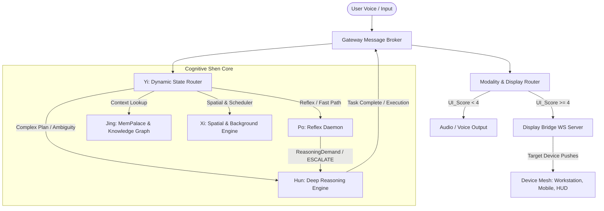
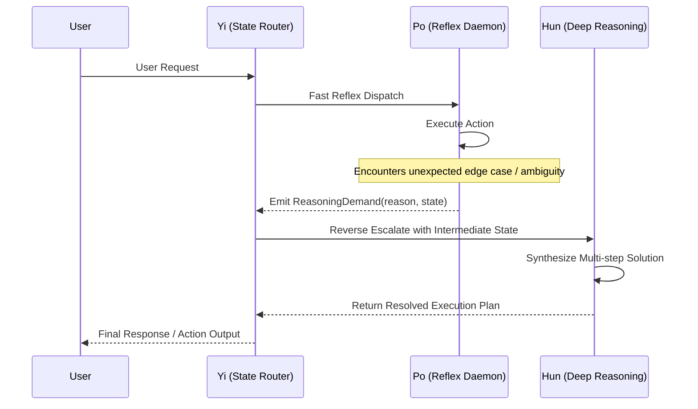

# Velvet Nadir System Architecture

> *"The best interface is no interface. The best AI is invisible until needed."*

Velvet Nadir is a personal, decentralized AI infrastructure designed for local execution across heterogeneous device mesh topologies. It combines an Eastern philosophy-inspired cognitive daemon architecture (*Shen*) with SOTA multi-agent orchestration patterns and a context-aware modality routing engine.

---

## 1. High-Level Architecture Diagram

---

## 2. Shen Daemons & SOTA Patterns

| Shen Daemon | SOTA Design Pattern | Function & Role |
|:---|:---|:---|
| **Yi** | **Dynamic State Router** (LangGraph dynamic edges) | Evaluates intent state, scores output modality, routes tasks dynamically across cognitive daemons. |
| **Hun** | **Orchestrator-Worker & Dual-Loop Ledger** (Magentic-One) | Multi-step deep reasoning, ambiguity resolution, and integration with `ModelAffinityTracker` for latency/ELO scoring. |
| **Po** | **Fast Reflex Handoffs** (OpenAI Swarm) | Low-latency single-turn reflex execution; emits `ReasoningDemand` to reverse-escalate to Hun when stuck. |
| **Jing** | **Blackboard Scratchpad** (Academic Blackboard) | Shared memory palace with Zenoh P2P mesh replication (`MeshMemorySync`) for decoupled daemon collaboration. |
| **Xi** | **Spatial Tracking & Background Execution** | Spatial centroid clustering (`TriangulationTask`), coordinate tracking (`LocusEngine`), and daemon task scheduling. |

---

## 3. Reverse Escalation Flow

---

## 4. Modality Decision Engine & Display Capabilities

Output modality is governed by the scoring formula:

$$\text{UI\_Score} = D + (V \times 1.5) + (M \times 2) + S$$

Where:
- $D$: Direct manipulation demand (e.g. 3D model rotation = 3, timeline scrubbing = 2)
- $V$: Visual representation complexity (e.g. multi-column comparison table = 2)
- $M$: Media workload presence (e.g. audio/video stream = 2)
- $S$: Spatial / structural hierarchy (e.g. directory tree = 1)

### Modality Level Routing:
- **`ZERO_UI`** ($\text{UI\_Score} < 2$): Ambient voice response. No visual UI rendered.
- **`MICRO_UI`** ($2 \le \text{UI\_Score} < 4$): Toast notification / HUD overlay on smart glasses or smart displays.
- **`WIDGET_UI`** ($4 \le \text{UI\_Score} < 7$): Floating direct-manipulation widget (Media Controller, 3D Model Inspector, File Explorer).
- **`MACRO_UI`** ($\text{UI\_Score} \ge 7$): Full workspace canvas takeover.

---

## 5. Security & Privacy Architecture

- **Basilisk Enclave**: Sandboxed P2P biometric authentication protocol over Zenoh (`capture_basilisk`).
- **Mirage Proxy**: Ephemeral PII redaction layer ensuring raw personal identifiers are stripped prior to external network requests.
- **Privacy Guard**: Fail-closed classification engine restricting sensitive data from untrusted mesh nodes.
